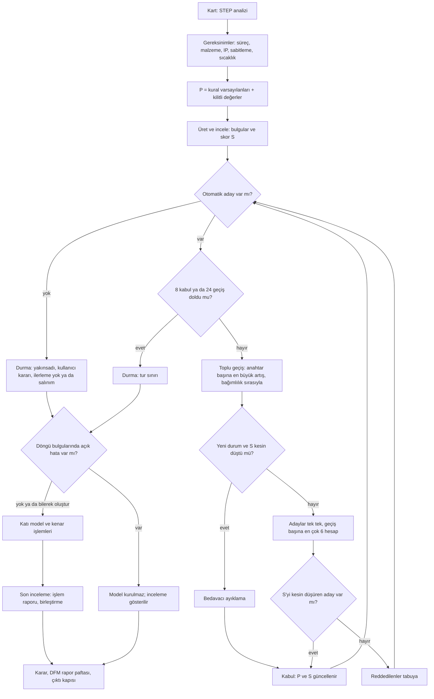

# Ikra Tasarım Algoritması

Muhafaza mühendisleri için tasarım ve inceleme el kitabı. Kapsam: alt gövde, kapak ve ayrı DIN ray klipsi; FDM, CNC ve enjeksiyon. İlgili kod: `web/js/design.js` (tasarım ve kontroller), `web/js/dfm/catalog.js` (kural kataloğu), `web/js/dfm/review.js` (inceleme), `web/js/dfm/loop.js` (düzeltme döngüsü), `web/js/treat.js` (kenar işlemi politikası), `web/js/cad-worker.js` (katı model), `web/js/design-ui.js` (arayüz), `web/js/drawing.js` (teknik resim ve DFM rapor paftası), `web/rules/` (kural dosyaları). Kaynakça: [KAYNAKLAR.md](KAYNAKLAR.md).

**Okuma notu.** [F8], [K5], [C4], [M1], [R1], [A3], [N2] gibi anahtarlar KAYNAKLAR.md'deki girdilerdir. Ondalık ayırıcı virgüldür; formüllerde bağımsız değişkenler noktalı virgülle ayrılır: max(0,5·d; 5·P). Durum işaretleri kuralın kaynağıyla karşılaştırılıp karşılaştırılmadığını gösterir: ✓ doğrulandı, ✎ düzeltilerek doğrulandı, ○ kontrol edilmedi. Eşiklerin bağlayıcı değeri `catalog.js`, `design.js`, `treat.js` ve `web/rules/` dosyalarındadır; bu belge gerekçeyi, dayanağı ve davranışı açıklar. Belge ile kod arasında ayrışma görülürse kod esastır.

## İçindekiler

1. Amaç ve kapsam · 2. Terimler · 3. Genel akış · 4. Karar sırası ve bağımlılık blokları · 5. Tasarım adımları · 6. İnceleme ve otomatik düzeltme döngüsü · 7. Kenar işlemleri politikası · 8. Süreç kuralları · 9. Elektronik muhafaza kuralları · 10. Anten ve RF kuralları · 11. Bilinen sınırlar ve sonraki aşamalar · 12. Sorumluluk notu · 13. Sürüm geçmişi

---

## 1. Amaç ve kapsam

Ikra, PCB'nin STEP montajından bir muhafaza tasarlar: alt gövde, kapak ve istenirse ayrı üretilen DIN ray klipsi. Gövde ve kapağın üretim yöntemi ve malzemesi ayrı seçilebilir; klips gövdenin süreciyle üretilir. Çıktılar PCB ile aynı koordinatlardaki STEP/STL modeller, teknik resim (DFM rapor paftasıyla), malzeme listesi ve inceleme raporudur. Bu belge kararların sırasını ve gerekçesini, kural kataloğunu ve dayanaklarını, hangi bulguların kendiliğinden düzeltildiğini, döngünün neden her zaman sonlandığını, katı modelin nasıl yeniden denetlendiğini ve süreç başına kenar işlemlerini tanımlar.

**Temel ilke: ilk hesap sonuç değildir.** Tasarım üretilir, kural kataloğuna göre incelenir, güvenli bulgular düzeltilir ve tasarım yeniden incelenir. Döngü durduğunda, döngü bulgularında açık hata yoksa katı model kurulur; katının işlem raporu ikinci kez incelenir (son inceleme) ve karar ancak bundan sonra verilir: **Hazır**, **Uyarılarla hazır** ya da **Üretime uygun değil**. Bu, bilgi tabanlı tasarımdaki "öner ve düzelt" (propose-and-revise) şemasının [A5] ve EDA araçlarındaki tasarım kuralı denetiminin [A1, A2] muhafaza tasarımına uyarlanmasıdır. Ürün maliyetinin %75–85'i tasarım ve planlamada belirlendiğinden [A23] DFM kuralları hem üreticiye gömülür hem de bağımsız bir incelemeyle ayrıca denetlenir.

Ikra bir sertifikasyon aracı değildir (§12). Sonlu elemanlar, kalıp dolum, RF benzetimi ve tolerans zinciri analizi bu sürümde yoktur.

## 2. Terimler

| Terim (İng.) | Anlamı |
|---|---|
| Et kalınlığı, t (wall) | Gövde yan duvarı; taban kalınlığı `floor_ratio` ile bundan türetilir. Kapak kalınlığı T aynı malzemede t'ye, farklı malzemede max(t; kapak `min_wall`) değerine eşittir. |
| Kavite, zarf | PCB'yi içine alan iç hacim; dış ölçü ve köşe radyüsleriyle tanımlı gövde kabuğu. |
| Standoff, boss | PCB'yi tabandan yükselten dikme; vida, insert ya da kılavuz deliği taşıyan kule. |
| İnsert, Helicoil | Isıyla plastiğe gömülen pirinç dişli burç; tel dişli burç. |
| Pah (chamfer) | Kenarın düzlemle kırılması; "0,5 × 45°" iki kenarı 0,5 mm olan pah. |
| Radyüs (fillet) | Kenarın yuvarlatılması; iç (içbükey) ve dış (dışbükey) ayrı ele alınır. |
| Kenar kırma (edge break) | Çapağı ve keskinliği gideren küçük pah ya da radyüs. |
| Giriş pahı (lead-in) | Birbirine geçen yüzlerde yerleşmeyi kolaylaştıran pah. |
| Köşe boşaltması (dogbone) | Döner takımın açamadığı keskin iç köşenin takım yarıçapıyla oyulması. |
| Kalıp çıkma açısı (draft) | Kalıp açılma yönüne paralel yüzlere verilen eğim. Paralel draft: iç ve dış yüze aynı yönde, et sabit kalır. |
| Ayırma çizgisi (parting line) | Kalıp yarımlarının birleştiği çizgi; Ikra'da gövde ağzının dış kenarı. |
| Kapak dili (lid lip) | Kapağın altından gövdeye girip kapağı konumlayan çıkıntı. |
| Yan maça (side action) | Açılma yönüne dik delik için kalıpta gereken hareketli parça. |
| Çöküntü (sink) | Kalın kesitin soğurken karşı yüzde bıraktığı çukur. |
| Fil ayağı, köprü | FDM'de ilk katmanların dışa taşması; altı boş yatay açıklık. |
| Kordon conta, kanal (gland) | Ağızdaki kanala oturan elastomer kordon; sıkıştırma ve doluluk kanalı boyutlandırır. |
| Yasak bölge (keep-out) | İçine belirli parçaların (ör. metal) giremeyeceği hacim. |
| Bulgu (finding) | Bir kuralın tasarıma uygulanmasının sonucu: hata, uyarı, bilgi ya da geçti. |
| Otomatik / Kilitli | Otomatik parametreyi kural dosyası ve döngü belirler; kullanıcının yazdığı değer kilitlidir, döngü onu değiştirmez. |
| Muafiyet (waiver) | Bir bulgunun gerekçe yazılarak kabul edilmesi. |
| Tabu | Döngünün aynı çalıştırmada yeniden denemediği reddedilmiş düzeltmeler. |

Arayüzde ve bu belgede **montaj** birleştirme anlamındadır (montaj STEP'i, montaj paftası). Kutunun duvara ya da raya bağlanması **kutunun sabitlenmesi**, PCB'nin gövdeye bağlanması **kart tutma** olarak adlandırılır. Katalogda sabitleme ailesinin kategori kimliği `montaj`, öneki MNT'dir; arayüz bu kategoriyi "Kutunun sabitlenmesi" diye gösterir. Bazı kural başlıkları ("Montaj kulakları", "Montaj vidası ölçü verisi") ve katı model satırları ("montaj kulağı") sözcüğü hâlâ sabitleme anlamında kullanır; PCB üzerindeki vida delikleri için yerleşik terim olan "(kart) montaj deliği" de korunur.

## 3. Genel akış



Döngü yalnızca parametrik tasarımı kapsar (`runDesignLoop`); katı model (replicad 1.2.1 + OpenCascade, ayrı iş parçacığında) döngü durduktan sonra kurulur. Her alt problem kendi yöntemiyle çözülür: zarf ve et için kapalı formül, vida, insert ve geçme için tablo, ölçü zinciri için yayılım, port ve panel yerleşimi için arama [A8]. Parametrik denetimler her girdi değişikliğinde, katı model denetimleri yalnızca model kurulunca çalışır [A2].

## 4. Karar sırası ve bağımlılık blokları

Parametreler arasındaki bağımlılıklar çevrimlidir. Tasarım yapı matrisi (DSM) yaklaşımında karşılıklı bağımlı gruplar tek blokta toplanır ve blok içinde bir bağımlılık "yırtılır": parametre tahmini bir değerle başlar, girdisi belli olunca doğrulanır [A9].

| Blok | Parametreler | Döngüyü kuran bağımlılık |
|---|---|---|
| B1 Zarf | et, taban, kapak kalınlığı, kavite, dış ölçü, köşe radyüsleri | Dış ölçü = kavite + 2t; r_o = r_i + t. Büyük iç radyüs PCB köşesi için daha çok boşluk, dolayısıyla daha büyük kavite ister. IP kanalı ağızda et ister; kanal iç köşe radyüsü r_i + t/2 − kanal genişliği/2'dir. |
| B2 Kart tutma | standoff yüksekliği, boss çapları, kapak borusu boyu, vida boyu, insert | İnsert ya da diş derinliği standoff yüksekliğini; vida boyu sıkıştırılan kalınlığı (kapak, üst boşluk) izler; standart boy seçilince standoff yeniden ayarlanır. |
| B3 Kapak | kapak dili, geçme boşluğu, conta kanalı, kapak boruları | Geçme boşluğu iki parçanın toleransından ve kural dosyasındaki malzeme payından (karma kapakta genleşme farkından) gelir; kanal genişliği ağız etini, ağız eti dilin yerini sınırlar; duvara yakın kapak boruları kapak boşluğu kadar kırpılır. |

Yırtılan parametre kural dosyasındaki önerilen değerle başlar. Doğrulama başarısızsa bulgu bir artış önerir, döngü (§6) bunu uygular; çevrimli bağımlılıklar sonlu turda çözülen bir sabit nokta problemine dönüşür. Döngü içinde bağımlılık sırası açıkça kodlanmıştır: et kalınlığı değişirse aynı geçişte diğer dört parametre, köşe radyüsü değişirse PCB boşluğu, üst boşluk değişirse PCB altı yükseklik değişmez (§6.4).

**Sıranın gerekçesi.**

1. **Süreç ve malzeme önce:** tüm eşikler bunlara bağlıdır; her parça kendi sürecinin kural grubuyla değerlendirilir [A21]. Kapak başka malzemedense kapağın süreç denetimleri kapağın kural dosyasıyla yapılır (§5).
2. **Zarf özelliklerden önce:** zarf geçici bir tahmindir; özellikler onu beş sayısal kanalla büyütebilir: `wall`, `pcbClearance`, `topClearance`, `standoffHeight`, `cornerRadius`.
3. **Kart tutma kapaktan, kapak portlardan önce:** kapak boruları ve vida boyu standoff yüksekliğine bağlıdır; IP kanalı port penceresinin üstünde kalacak duvar payını belirler.
4. **Portlar, panel, sabitleme sonra:** zarf içindeki yerleşim problemleridir; sığmazlarsa üst boşluk artışı isterler.
5. **Kenar işlemleri en son:** nihai topolojiye ve radyüslere bağlıdır (iç taban radyüsü iç köşe radyüsünden küçük olmalı). Conta kanalı iç köşe radyüsü köşe radyüsünü etkilediğinden önce kesinleşir. Çıkma açısı OCCT'nin yüz eğme işlemiyle (DraftAngle) verilmez: bu işlem teğet yüz zincirleri boyunca yayıldığı için radyüslü komşu yüzlerde öngörülemez sonuç verir. Bunun yerine açılı ilkel katı, yuvarlatılmış dikdörtgen kesitler arasında düz yüzeyli (ruled) loft olarak kurulur; radyüsler ve Boole işlemleri bundan sonra gelir (§7).

**Kural aileleri arasındaki öncelik:** (1) sığma ve işlev (kart sığar, fiş takılır, anten yasak bölgesi, sızdırmazlık), (2) katı üretilebilirlik (en az et, takım erişimi, kalıptan çıkma), (3) yumuşak üretilebilirlik (önerilen et, düzgün et, cömert radyüs), (4) montaj ekonomisi, (5) boyut, kütle, görünüş. Bu sıra yayımlanmış bir kaynaktan değil, araştırma notlarındaki sentezden gelen bir tasarım tercihidir. Kodda doğrudan kodlanmaz: döngüde önce seviye (hata, uyarı, bilgi), sonra katalog öncelik numarası belirleyicidir ve öncelik numarası aile sırasını yalnızca kabaca izler (ör. RF-KEEPOUT-METAL 57, CNC-CORNER-TOOL 20). Katı kurallar her zaman, yumuşak kurallar mümkün olduğunca karşılanır; karşılanmayan yumuşak kural engelleyici olmaz [A12].

## 5. Tasarım adımları

**Gereksinimler.** Parça başına süreç ve malzeme, IP (yok, IP65, IP66, IP67), kutunun sabitlenmesi (yok, kulak, tabandan vida, DIN) ve isteğe bağlı en yüksek çalışma sıcaklığı. Sıcaklık girilirse **REQ-TEMP** gövde malzemesinin (kapak ayrı malzemedense kapağın da) kural dosyasındaki sürekli kullanım sıcaklığını (`max_service_temp_c`) istenen değerle karşılaştırır: yetersizse hata ve aynı süreçte gereksinimi karşılayan malzemelere geçiş önerisi (en çok üç seçenek: önce katkısız plastikler en düşük yeterli sıcaklıktan, sonra karbon katkılılar, sonra metaller), yeterliyse geçti. Kartta anten bölgesi varsa (RF kurallarıyla aynı ölçüt: anten adlı parça, yoksa RF modülü) metal önerilmez (RF-METAL-BODY), karbon katkılı malzeme yalnızca katkısız seçenek yoksa ve anteni zayıflatacağı notuyla önerilir (RF-LOSSY-MATERIAL). Bu bulgu döngüye girmez ve katı model kurulmasını engellemez, ama kararı "Üretime uygun değil" yapar ve muaf tutulabilir. Gerilim, güç, ortam, RF bandı ve kirlilik derecesi henüz girdi değildir (§11).

**Zarf.** Kavite = PCB sınır kutusu + her yanda kart–duvar boşluğu. İç köşe radyüsü PCB köşesine değecekse (köşede 0,2 mm'den az pay) boşluk tasarım içinde artırılır ve **GEN-CORNER-CLEARANCE** bilgisi olarak karar kaydına düşer [A27]. Karttan taşan ama dışarıdan erişim gerektirmeyen parçalar (ör. modülün PCB anteni) kaviteye alınır. Düşeyde taban üstü PCB'nin standoff yüksekliği kadar altında, kavite üstü en yüksek bileşenin üst boşluk kadar üstündedir. r_o = r_i + t eş merkezlidir; köşede et korunur [K9]. Başlangıç değerleri: `default_wall`, `pcb_clearance_xy`, `component_clearance_z`, max(`min_standoff_height`; alttan taşan + `under_board_clearance`), `corner_radius_min`.

**Kart tutma.** Vida boyutu PCB deliğinden seçilir (M2–M4). Gövde tarafı sürece ve seçime göre: ısıl insert, kılavuz, Helicoil, sac vidası ön deliği, somun cebi ya da hazır aralayıcı. İnsert boss'u için kaynağın alt sınırı delik çapı D3 + 2W'dir (M3: 4,0 + 2 × 1,6 = 7,2 mm) [F18], [F19]; Ikra daha tutucu olarak insert dış çapı D1 + 2W'yi (M3: 7,8 mm) kullanır, ayrıca boss çapı `boss_min_diameter` ve delik + 2 × `boss_outer_wall` değerinden küçük olmaz. Kör delik insert boyu + 1 mm'dir [F17]; kılavuzlu kör delikte diş boyuna matkap ucu payı eklenir (§8.2).

**Kapak birleşimi.** Kapak dili, altında yüksek bileşen varsa kısaltılır ya da kaldırılır (bileşenle 0,3 mm pay; 4 mm'den kısa dil parçası üretilmez). Duvara ulaşmayan (geri çekilmiş ya da duvara yakın) açık bir konnektörün ön yüzüyle iç duvar arasındaki koridor fişin ve kablonun yoludur: açıklık genişliği × konnektör ön yüzü → iç duvar × açıklığın üst kenarına kadar. Tam boy dil bu koridora sarkarsa açıklığı içeriden kapatır; bu yüzden iki seçenek karşılaştırılır: dil açıklığın önünde bölünür (açıklık ± 0,3 mm, CNC kapakta boşluk en az kapak frezesi çapı kadar; parçalar kenardaki diğer bileşenlere göre kısalır) ya da bölünmeden tüm kenar fiş yolunun 0,3 mm üstünde biter. Dil alanı (boy × derinlik) büyük olan seçilir ve **LID-LIP-SHORT** bilgisiyle ("açıklığının önünde kesildi") yazılır; ikisi de dil bırakmıyorsa dil **LID-LIP-REMOVED** ile kaldırılır. Duvardan geçen konnektörde fiş yolu konnektörün kendisidir, dil onun üstünde biter (bileşen kuralı). Dil–cep boşluğu her yanda `fits.js` `lidGap` ile hesaplanır: geçme sınıfı boşluğunun yarısı + yüzey sapması (`lid_extra`) + boy payı (`per_100mm` · L/400). Kural dosyasındaki `lid_fit_clearance`, malzeme varsayılanlarıyla normal geçmedeki en küçük boşluktur; bununla model boşluğu arasındaki fark **ek malzeme payı** olarak normal ve bol geçmeye eklenir, sıkı geçmeye eklenmez. Pay kural varsayılanlarından hesaplandığı için kullanıcının tolerans düzeltmesi boşluğu her zaman aynı yönde değiştirir; `lid_min` düzeltmesi payı ezer (0 = pay yok). Farklı malzemeli kapakta boşluk iki malzemenin ortalaması + ΔT = 40 K'deki genleşme farkının yarısıdır. IP'de kanal derinliği = kordon çapı × (1 − sıkıştırma), genişlik doluluk sınırından, ağız eti = genişlik + 2 × yan pay (FDM'de nozul katına yuvarlanır). Gövde duvarına kapak boşluğundan yakın inen kapak boruları ve köşe vidası yastıkları duvar tarafında kırpılır; kalan et **LID-TUBE-WALL** ile raporlanır. Kapak ayrı süreç ya da malzemedense kapağın süreç denetimleri kapağın kural dosyasıyla yapılır ve "Kapak" parçasıyla etiketlenir: FDM'de kalınlığın nozul katı ve çarpılma, CNC'de dil ve boruların takım derinliği, enjeksiyonda INJ-DRAFT (yüzey başına), INJ-LIP-RATIO, INJ-BOSS-WALL (kapak boruları), INJ-UNIFORM-WALL, INJ-SHRINK; RF denetimleri de kapağın iletkenliğine bakar.

**Portlar, panel, sabitleme.** Açıklığı yalnızca duvar düzlemine taşan kesit belirler. IP'de pencere zorunlu, enjeksiyonda yan maça gerekmesin diye çentik önerilir, CNC'de açıklık köşe radyüsü seçili freze çapına göredir (1,3 × takım yarıçapı; dar açıklıkta açıklığa sığan en büyük radyüs). Yuvarlak köşe konnektör kesitinin köşesine binmesin diye açıklık her yanda e = (r − c)·(1 − 1/√2) büyütülür (c: kesim boşluğu). Pay modelde gerçekten kullanılan radyüsle hesaplanır: r ile e birbirine bağlı olduğundan freze radyüsüyle başlanır ve açıklığa sığan radyüsle yeniden hesaplanır (sabit nokta, birkaç adımda yakınsar); radyüs her adımda küçüldüğünden pay o adımdaki radyüs için yeterlidir. Böylece dar açıklıklar ve büyük frezeler açıklığı gereksiz büyütmez (Ø12'de komşu açıklıklar birleşmez, Ø3'te küçük konnektörlerin üstündeki duvar inceltilmez). Konnektör ön yüzü dış yüzeyden 1,5 mm'den fazla içerideyse **PORT-RECESS** uyarısı nedeni ayrı ayrı yazar: iç köşe radyüsü payı (GEN-CORNER-CLEARANCE), köşe vidası payı (yalnız o eksende) ve et kalınlığı. Yalnız sınırı gerçekten sağlatan çözüm önerilir: köşe payı ekseni, daha küçük iç köşe radyüsü (CNC'de radyüs frezeden geliyorsa daha küçük freze) ya da fiş ölçüsüne göre büyütülmüş açıklık; kavite hiç büyümese de sınır aşılıyorsa neden et kalınlığıdır. Kavite iç köşe radyüsü ya da köşe vidası payı için büyüdüğünde kullanıcının PCB–duvar boşluğunda duvardan geçecek konnektör "geri çekilmiş" port sayılır ve açıklığı açılır; aynı büyüme payı kadar duvara yakın (konnektör olmayan) parçalar da port adayı olarak listelenir ama kapalı gelir (ör. LED, kamera FFC soketi). Bu iki kural ve köşe payı birlikte CNC tasarımlarını şöyle etkiler: Ø3'te 4 mm'den büyük açıklıklar her yanda ≈ 0,5 mm büyür (radyüs tam R1,95 olduğundan pay da tamdır); pencerenin üstünde kalan duvar bu yüzden 1,5 mm'nin altına inerse açıklık çentiğe döner (PORT-AUTO-NOTCH, ör. örnek karttaki klemens); IP'li köşe kapaklı tasarımlarda açıklığın üstünde conta kanalı ve et payı kalsın diye (IP-PORT-BRIDGE) döngü bileşen üstü boşluğu artırabilir, kutu yükselir. Panel elemanları zarf içinde aranarak yerleşir. DIN klipsi EN 60715 TS35 rayına (35 mm, 7,5 mm, 1 mm sac [M21] ○, [N3]) göre boyutlanır; kilit dilinin gerinimi malzemenin izin verilen gerinimiyle karşılaştırılır.

**CNC freze takım çapı.** CNC'de iç köşe radyüsleri, cep derinliği oranı, port açıklığı köşeleri, köşe boss'u birleşim radyüsü, somun cebi köşe boşaltması ve CNC kapak (aynı malzemede de) aynı parmak freze çapıyla hesaplanır: değer kavite köşelerini ve cepleri bitiren frezedir, köşe radyüsü duvarın tüm yüksekliği boyunca bu frezeyle açıldığı için cep derinliği de bu çapla değerlendirilir (çok küçük freze derinlik uyarısı ya da hatası verir). İç köşe sınırı seçilen frezeden türetilir (`treat.js cncCornerLimits`): en az takım yarıçapı + kural dosyasının 0,1 mm payı, önerilen 1,3 × takım yarıçapı; freze seçilmediyse kural dosyasındaki `corner_radius_min` taban kalır. Port açıklığı köşeleri de 1,3 × takım yarıçapıdır; frezeden dar açıklık o frezeyle açılamaz ve **CNC-CUTOUT-TOOL** uyarısı ayrı ve daha küçük bir freze ister. Değer kullanıcı seçimidir (`toolDiameter`; arayüzde 0,5–12 mm, motor 0,5–20 mm aralığını kabul eder), boşsa kural dosyasının `process_params.tool_diameter` değeri (bugün tüm CNC dosyalarında Ø3) kullanılır. Değer geometriye (`geometry.toolDiameter`, `lidToolDiameter`) yazılır; `treat.js` ve `cad-worker.js` aynı çapı kullanır. Freze çapı döngü parametresi değildir: döngü onu hiç değiştirmez; kullanıcı alana yazarak ya da bir öneri düzeltmesini ("Ø2,5 mm freze seç") uygulayarak değiştirir, kilitler, geri alır ya da "Tüm kilitleri kaldır" ile kural değerine döndürür; değer proje dosyasında saklanır. Önerilen freze, cep derinliğini işleyebilen (CNC-POCKET-DEPTH hata sınırının altında kalan) çaplar arasından seçilir; gövde ve kapak ikisi de CNC ise freze çapını paylaştıkları için öneri iki parçanın en derin işlemesini karşılar (biri için yeterli çap diğerini hatada bırakmaz). İç köşe radyüsü önerilen frezenin 1,3 × yarıçap kuralının altındaysa düzeltme yeni radyüsü de taşır ("Ø2,5 mm freze ve R1,65 iç köşe seç"): radyüs kilitliyse arayüz onu da günceller, kilitli değilse döngü CNC-CORNER-TOOL ile yükseltir.

## 6. İnceleme ve otomatik düzeltme döngüsü

### 6.1 Kural kataloğu

Tasarım bilgisi koddan ayrı, bildirimsel bir katalogda tutulur; üretici ve inceleyici aynı kataloğu okur [A1]. Katalogda 128 kural vardır. Her kuralın kimliği, Türkçe başlığı, kategorisi, geçerli süreçleri, varsayılan seviyesi, **nedeni** (ihlal edilirse ne olur), kaynakları, güveni (yüksek/orta/düşük) ve önceliği (küçük sayı döngüde önce denenir) vardır. Önekler aileyi gösterir: GEN genel, REQ gereksinim, FDM, CNC, INJ süreç, PORT port açıklığı, LID kapak, FAS bağlantı elemanı, MNT kutunun sabitlenmesi, PNL panel elemanı, EDGE kart kenarı tutucu, IP sızdırmazlık, RF anten, GEO katı model. Kategoriler: genel, surec, port, kapak, baglanti, montaj, panel, ip, rf, geometri. Kataloğa bağlı olmayan bir bulgu `uncatalogued` işaretini alır. İlkeler:

- **En özgül kural kazanır:** kullanıcı kilidi > malzeme > süreç > genel varsayılan [A1, A2].
- **Düşük güvenli kural engelleyici değildir.** Katalogda düşük güvenli hiçbir kural hata seviyesinde tanımlı değildir; otomatik bir uyarı parçanın yapılamayacağının kanıtı değildir [A14]. Hata seviyesindeki kurallar doğrulanmış bir eşiğe, modelden ölçülen bir geometrik çakışmaya (ör. GEN-STANDOFF-BELOW, FAS-COLLIDE, PORT-CROSS-CLOSED), eksik ya da geçersiz veriye (GEN-INPUT, FAS-TYPE-SIZE, MNT-DATA) ya da kullanıcının açık gereksinimine (REQ-TEMP) dayanır; kontrol edilmemiş kaynaklar bu kurallarda yalnızca bağlam verir.
- **Düzeltme yalnızca ihlale katkı veren parametreye dokunur;** onarım yerel ve açıklanabilir kalır [A5].

Seçilmiş kurallar (tam liste `catalog.js`):

| Kimlik | Konu ve eşik | Kaynak | Düzeltme |
|---|---|---|---|
| GEN-WALL-MIN | Et ≥ `min_wall` (kural dosyası) | [K1], [C1], [F5] | otomatik: `wall` ↑ |
| GEN-STANDOFF-BELOW | PCB altı yükseklik ≥ alttan taşan + 0,2 mm; STEP'ten ölçülen geometrik çakışma denetimi | [M25] ○, [M20] ○ (bağlam) | otomatik: `standoffHeight` ↑ |
| GEN-STANDOFF-GAP | Kart altı hava boşluğu ~`under_board_clearance` (1 mm); bilgi, düşük güven | [M25] ○, [M20] ○ | otomatik: `standoffHeight` ↑ |
| REQ-TEMP | `max_service_temp_c` ≥ en yüksek çalışma sıcaklığı | [M29] ○, [M30] ○, [N8] | öneri: malzeme (anten bölgesi varsa metal önerilmez, karbon katkılı yalnızca başka seçenek yoksa) |
| FDM-WALL-NOZZLE | Et nozul çapının katı | [F1], [F2], [F5], [F9] | otomatik: `wall` bir üst kata |
| FDM-CORNER-NOZZLE | r_i ≥ nozul çapı | [F8] | otomatik: `cornerRadius` ↑ |
| FDM-BRIDGE | Pencere köprüsü ≤ 5 mm geçti, 5–10 mm bilgi, > 10 mm uyarı | [F8], [F16] | öneri: çentik |
| FDM-INSERT-DEPTH | Kör delik ≥ insert boyu + 1 mm | [F17], [F18] | otomatik: `standoffHeight` ↑ |
| CNC-CORNER-TOOL | r_i < Ø/2 + 0,1 (freze seçilmediyse `corner_radius_min`) hata; r_i < 1,3 × Ø/2 uyarı | [C5], [C4], [C8] | otomatik: `cornerRadius` ↑; seçenek: köşeye uyan ve cebi işleyebilen daha küçük freze |
| CNC-CORNER-DEPTH | r_i < derinlik/8 uyarı; r_i < derinlik/4 bilgi | [C4], [C1] | öneri: `cornerRadius` (döngü uygulamaz) |
| CNC-POCKET-DEPTH | Cep derinliği > `max_depth_ratio` × Ø (4 × Ø) uyarı; > 10 × Ø ya da Ø ≤ 1 mm iken > 9,52 mm hata (gövde ve CNC kapak) | [C1], [C18], [C19], [C12] | hatada öneri: gövde cebini ve CNC kapağı birlikte işleyebilen en küçük standart freze (gerekirse yeni iç köşe radyüsüyle) |
| CNC-CUTOUT-TOOL | Port açıklığı (pencerede en ve boy, çentikte en) ≥ Ø; köşe radyüsü ≥ Ø/2 | [C1], [C5], [C12] | yok (ayrı freze ya da büyük açıklık) |
| CNC-TAP-DEPTH | Kör delik ≥ diş boyu + max(0,5·d; 5·P), ek en çok 5·P + 1,5 mm | [C4], [C20] | otomatik: `standoffHeight` ↑ |
| CNC-NUT-POCKET-TOOL | Freze yarıçapı ≤ s/4 − 0,02 mm; aşılırsa freze cebin anahtar ağzından genişse hata (cep yuvarlak, somun dönmeye karşı tutulmaz), değilse somun köşe yayına oturma sınaması: girişim hata, düz kısım < 0,5 mm uyarı, pay bilgi (§8.2) | [C5], [C1] (türetilmiş sınır) | öneri: Helicoil ya da sınırı aşmayan standart freze |
| INJ-DRAFT | `injectionDraft` (§8.3); ön incelemede bilgi, katı modelde doğrulanır | [K5], [K6] | geometride; yetersizse uyarı |
| INJ-CORNER-RADIUS | r_i ≥ max(0,5 t; 0,5 mm), o anki et kalınlığıyla | [K8], [K9], [K7] ○ | otomatik: `cornerRadius` ↑ |
| INJ-BOSS-WALL | Boss eti ≤ 0,6 t | [K4], [K10] | yok; metinde çöküntü önlemi (vida tablosu öncelikli) |
| IP-RIM | Et ≥ kanal genişliği + 2 × yan pay | [M1] | otomatik: `wall` ↑ |
| IP-GROOVE-RADIUS | Kanal iç köşe radyüsü r_i + t/2 − genişlik/2 ≥ 3 × kordon (ideal 6×); IP-RIM geçmeden değerlendirilmez | [M1] | otomatik: `cornerRadius` ↑ |
| IP-CLAMP-PITCH | Conta boyunca en büyük sıkıştırma aralığı ≤ `max_clamp_pitch` (düşük güven) | [M3], [M1]; sayılar kurum varsayılanı | öneri: köşe vidaları |
| LID-TUBE-WALL | Duvara kapak boşluğundan yakın boru/yastık kırpılır; düzleşen yüzde kalan et < kapak `min_wall` uyarı | [K4], [K1], [F5] | öneri: deliği kullanmama |
| RF-KEEPOUT-METAL | Anten çevresinde 15 mm içinde metal vida, insert, aralayıcı, somun, tabandaki montaj vidası, DIN rayı | [R1], [R3], [R14] | öneri: plastik vida, deliği kullanmama |
| RF-METAL-BODY | İletken gövdede iç anten | [R8], [R14], [R4] ○ | öneri: panel SMA |
| RF-LOSSY-MATERIAL | Karbon elyaf dolgulu malzeme (PA-CF, PETG-CF) anten bölgesinde | [R16] ○, [R8] | yok; metinde öneri |
| GEO-* | Katı model sonrası kenar işlemi ve kurulum (§6.7) | §7 | geri düşüş ve raporlama |

### 6.2 Bulgu ve seviyeler

Her bulgu şunları taşır: kararlı kimlik (kural + odak parça + rakamları atılmış metnin özeti; yeniden üretimde aynı kalır, muafiyetler buna bağlanır), kural kimliği, seviye, kategori, parça (gövde, kapak, klips, tümü), başlık, mesaj, ölçülen değer, sınır, karşılaştırma işleci ve birim, katalogdan neden, kaynak ve güven, düzeltme (parametre, hedef, etiket; otomatik ya da öneri), varsa düzeltme seçenekleri (`fixes`, ilki düzeltmenin kendisi), odak (3B'de vurgulanacak bileşen), muafiyet ve otomatik düzeltildi işareti; kapak INJ-DRAFT bulgusu ayrıca yüzey başına sınırları (`limits`: plaka, dil, boru, kart baskı dili) taşır. Mesajın ilk cümlesi tek başına anlaşılır: ne, nerede, ne kadar [A14]. Örnek: "USB-C açıklığı yanındaki duvar 0,9 mm; ABS için alt sınır 1,2 mm." Sonraki cümleler nedeni ve çözümü verir; dil yansızdır ve yapıcı bir çözüm önerir [A24]. Seviye renkle birlikte simge ve metinle gösterilir.

| Seviye | Sabit anlamı | Tasarım durumuna etkisi | Dayanak |
|---|---|---|---|
| **Hata** | Parça tasarlandığı hâliyle yapılamaz ya da fiziksel çakışma vardır. | "Üretime uygun değil"; döngü bulgularında açık hata varken katı model kendiliğinden kurulmaz. | Protolabs gerekli değişiklik [A15]; Fictiv kırmızı [A18] |
| **Uyarı** | Yapılabilir; kalite, maliyet ya da montaj riski var. Mesaj, göz ardı edilirse ne olacağını söyler. | "Uyarılarla hazır". | Protolabs öneri niteliğinde [A15]; Fictiv turuncu [A18] |
| **Bilgi** | Süreç notu, karar kaydı, ölçü bilgisi. | Yok; otomatik düzeltmesi olan bilgi skora 1 puan katar. | — |
| **Geçti** | Denetim çalıştı, koşul sağlandı. | Neyin denetlendiğini gösterir. | NX DFM Advisor [A20]; SARIF [A13] |

### 6.3 Otomatik düzeltme, öneri, kilit, muafiyet

**Otomatik düzeltme**, işlevi, malzeme listesini ve görünüşü değiştirmeyen, yalnızca zarfı ya da boşlukları büyüten güvenli bir adımdır [A3]. Yalnızca beş parametrenin **artışı** otomatik uygulanır: `wall`, `pcbClearance`, `topClearance`, `standoffHeight`, `cornerRadius`. Bir düzeltmenin otomatik sayılması için sayısal olması, `auto: false` taşımaması, anahtarın kilitli olmaması ve değeri artırması gerekir; hedef 0,05 mm'ye yukarı yuvarlanır; hedefi üst sınırın (et 12, PCB boşluğu 10, üst boşluk 60, PCB altı 60, köşe radyüsü 30 mm) üstünde kalan düzeltme aday olmaz ve kullanıcı kararına kalır. Bir geçişte her parametreye tek düzeltme uygulanır; aynı parametre için birden çok istek varsa gerekli en büyük artış seçilir, çünkü en büyük değer tüm alt sınırları birlikte karşılar [A3].

**Öneri**, işlevi, uyumu ya da görünüşü değiştirebilecek her şeydir: vida boyutu, tipi ya da malzemesi, insert tipi (ör. Helicoil), freze çapı, kapak bağlantı yöntemi, port biçimi (çentik), panel elemanı eklemek, bir deliği kullanmamak, malzeme, `auto: false` işaretli sayısal düzeltmeler (ör. CNC-CORNER-DEPTH). Öneriler döngüde uygulanmaz; mühendis "Uygula" ile birini seçerse döngü baştan çalışır. Birden çok seçeneği olan bulguda (ör. CNC-NUT-POCKET-TOOL: Helicoil ya da Ø2,5 mm freze) her seçenek ayrı düğmedir. Yanıtlar Protolabs'ın üç yönlü yapısına karşılık gelir [A16]: uygula, gerekçeyle muaf tut, açık bırak.

**Otomatik düzeltildi işareti.** Döngünün değiştirdiği bir kuralın yalnızca artık geçen bulguları "otomatik düzeltildi" işaretini alır; kuralın açık ya da geçen hiçbir bulgusu kalmadıysa "Otomatik düzeltildi: …" metinli bir geçti kaydı eklenir. Açık kalan bulgu hiçbir zaman otomatik düzeltilmiş sayılmaz.

**Kilit.** Kullanıcının elle yazdığı her parametre kilitlidir ve `.ikra.json` içinde saklanır. Döngü kural varsayılanlarının kilitli değerlerle güncellenmiş hâliyle başlar ve kilitli değeri hiç değiştirmez; kilitli parametreye dokunan düzeltme uygulanmaz ve bulgu açık kalır; bulgu hata ya da uyarıysa durma nedeni "kullanıcı kararı" olur. Böylece motorun bulduğu bir değer kalıcı bir "elle girilmiş" değere dönüşmez. Bir otomatik düzeltmenin "Geri al" düğmesi parametreyi önceki değerinde kilitler. Süreç ya da malzeme değişince kilitler korunur. Kilit bilgisi olmayan eski projelerde yalnızca döngünün değerinden büyük ya da kural varsayılanından küçük değerler elle girilmiş sayılır; eski projeler bu yüzden değişmeden açılır.

**Muafiyet.** Hata ve uyarılar gerekçe yazılarak muaf tutulabilir; gerekçe boşluklar dışında en az 3 karakter olmalıdır, daha kısa gerekçeli kayıt yok sayılır. Muaf bulgu skora ve duruma katılmaz, ayrı sayılır ve raporda, proje dosyasında ve teknik resimde gerekçesi ve tarihiyle "muaf" olarak kalır [A13]; kuralı kapatmaz, yalnızca o bulguyu kapsar [A1]. Muafiyet bulgunun kararlı kimliğine bağlıdır. Kimlik rakamları attığı için ölçülen değer değişince muafiyet aynı bulguya bağlı kalır; bu yüzden muafiyet verilirken ölçü ve sınır da kaydedilir (`measured`, `limit`, `op`, `unit`). Ölçü ya da sınır kuralın yönüne göre kötüleşirse (≥ kuralında ölçü küçülür ya da sınır büyürse, ≤ kuralında ölçü büyür ya da sınır küçülürse) ya da birimi değişirse muafiyet bulguyu örtmez: bulgu yeniden açılır, muafiyet eşleşmeyenlerde "ölçü kötüleşti" notuyla, sınır da değiştiyse "sapma kötüleşti" notuyla (ör. REQ-TEMP'te gereksinim 105 °C'den 120 °C'ye çıkınca `100 °C < 105 °C → 100 °C < 120 °C`), birim değiştiyse "ölçü birimi değişti" notuyla görünür (`review.js waiverWorsened`, `applyWaiver`). Parmak izi aynı kaldığı hâlde sınırı değişen bulgular gereksinim sıcaklığı (REQ-TEMP) ve derinliğe bağlı köşe radyüsü (CNC-CORNER-DEPTH) gibi kurallardır. Ölçü kaydı olmayan eski muafiyetlerde bu denetim yapılmaz, sınır kaydı olmayanlarda yalnızca ölçü denetlenir. Hiçbir bulguyla eşleşmeyen muafiyetler (sorun giderilmiş ya da bulgu metni değişmiş) "Eşleşmeyen muafiyetler" altında gerekçeleriyle listelenir ve yeni bir sorunu sessizce örtmesin diye başka bulguya aktarılmaz; yalnızca katı modelde üretilen bulguların muafiyetleri model güncel değilken listelenmez. Muaf bir hata katı modelin kendiliğinden kurulmasına izin verir. Engelleyici bir bulguyu muaf tutmak üretilebilirlik sorumluluğunu gerekçeyi yazan mühendise devreder; önerilmez.

### 6.4 Skor ve döngü

```
S = 1 000 000 · E + 1 000 · U + B
E: açık hata, U: açık uyarı, B: otomatik düzeltmesi olan açık bilgi (muaflar hariç)
```

Ağırlıklar skoru uygulamada sözlük sırasına çevirir: tek hata 999 uyarıdan ağırdır, bilgi yalnızca eşitliği bozar [A11]. Yeni bulgu doğuran her adım reddedilmez; toplam skor düşüyorsa daha hafif bir bulgu pahasına daha ağırını gideren adım kabul edilir.

```
P ← kural varsayılanları ⊕ kilitli değerler;  D ← incele(üret(P));  S ← skor(D)
T ← ∅ (tabu);  H ← {özet(P)};  kabul ← 0;  geçiş ← 0
sürekli:
  A ← D'deki muaf olmayan bulguların düzeltmeleri: beş parametreden biri, kilitsiz, auto ≠ false,
      hedef = yukarı 0,05 mm'ye yuvarlı değer, P[anahtar] < hedef ≤ SINIR[anahtar], (kural, anahtar, hedef) ∉ T
  A boşsa: çık
  kabul ≥ 8 ya da geçiş ≥ 24 ise: dur → max-iter
  geçiş ← geçiş + 1
  toplu ← her anahtar için en büyük hedef (eşitlikte küçük öncelik numarası, sonra ağır seviye);
          sıra et → köşe radyüsü → PCB boşluğu → üst boşluk → PCB altı; değişen anahtarın akış aşağısı
          (et: diğer dördü; köşe radyüsü: PCB boşluğu; üst boşluk: PCB altı) bu geçişe alınmaz
  özet(P ⊕ toplu) ∈ H ise: salınım işareti; değilse S' < S ise toplu kabul
  (tek üyeli toplu reddedilirse o aday T'ye girer)
  kabul yoksa: A'yı seviye, öncelik, parametre sırası, büyük hedef önce, kural kimliği sırasıyla dene;
               aynı (anahtar, hedef) bir kez, geçiş başına en çok 6 hesap;
               S'yi kesin düşüren ilk aday kabul; düşürmeyen ve salınım yapan adaylar T'ye
  kabul yoksa: sürdür (yeni aday kümesiyle)
  toplu kabulde bedavacı ayıklama: kendi bulgusu iyileşmeyen üye çıkarıldığında S artmıyorsa
               üye geri alınır ve T'ye girer ('etkisiz')
  P, D, S ← kabul edilen;  H ← H ∪ {özet(P)};  kabul ← kabul + 1
çıkışta: açık hata/uyarıların hiçbirinde düzeltme kalmadıysa → converged
         son geçiş reddedildi ve bekleyen düzeltmelerden biri T'deyse → stalled (salınım işaretliyse oscillation)
         aksi hâlde → needs-user
```

Adaylar tam belirlenimci sıradadır; rastgelelik ya da zamana bağlı adım yoktur ve aynı girdi aynı sonucu verir. Birleşik deneme skoru düşürmezse adayların tek tek, aynı anahtarın başka kurallardan gelen küçük hedefleri de dahil denenmesinin nedeni, saf açgözlü onarımın her girdide başarılı olmamasıdır: asansör tasarımı VT denemelerinde olası girdilerin yarısından fazlasında başarısız olmuştur [A6]. Her değişiklik kaydı tur numarasını, kuralı, parametreyi, önceki ve yeni değeri ve tetikleyen bulgunun ölçülen değerini, sınırını, işlecini ve birimini taşır; her ret kaydı ayrıca nedenini (`no-gain` bulguları azaltmadı, `oscillation` önceki duruma döndü, `no-effect` etkisi olmadı) ve doğuracağı yeni hata ve uyarı kurallarını taşır.

### 6.5 Sonlanma güvenceleri

1. **Tur sınırı.** En çok 8 kabul edilen geçiş ve 24 geçiş (kabul + ret); geçiş başına en çok 7 hesap (toplu deneme ve ardından ya en çok 6 tekli deneme ya da en çok 2 bedavacı denemesi; bağımlılık blokları nedeniyle toplu geçişte en çok iki anahtar bulunur). ESLint düzeltme turlarını 10 ile sınırlar [A3]; süreç araştırmaları 3–5 tur önerir. 8, tarayıcıda milisaniye mertebesinde süren turlar için düşük maliyetli bir üst sınırdır.
2. **Kesin azalan skor.** S negatif olmayan bir tam sayıdır ve kabul edilen her geçiş onu en az 1 azaltır.
3. **Tek yönlü, sınırlı düzeltmeler.** Yalnızca artış vardır, hedefler 0,05 mm ızgarasındadır ve her parametrenin üst sınırı vardır (§6.3); tek yönlü adımlar sonlu bir kümede sabit noktaya ulaşır [A10]. Sınırın üstündeki bir hedef aday olmaz ve kullanıcı kararına kalır.
4. **Tabu.** Reddedilen (kural, anahtar, hedef) üçlüsü aynı çalıştırmada yeniden denenmez; aynı kuraldan gelen daha büyük bir hedef yeniden aday olabilir.
5. **Durum özeti.** Daha önce görülen bir parametre durumu yeniden hesaplanmaz ve salınım olarak kaydedilir; artışlar tek yönlü olduğundan bu, kuramsal varsayımı bozabilecek bir uygulama hatasına karşı ikinci emniyettir [A4].
6. **Önbellek.** Son 8 sonuç girdinin anahtarıyla (kural dosyası, analiz, kilitler, muafiyetler, seçenekler, freze çapı) saklanır; dönen sonuç her zaman derin kopyadır, çağıranın sonuca yazdıkları önbelleği bozmaz.

Bu gerekçe veri akışı analizindeki sabit nokta sonucuna dayanan bir benzetmedir; yayımlanmış bir DFM sonucu değildir.

### 6.6 Durma nedenleri ve tasarım durumu

| Durma nedeni | Anlamı | Mühendise düşen |
|---|---|---|
| `converged` Yakınsadı | Otomatik aday kalmadı ve açık hata ya da uyarıların hiçbirinde uygulanmamış düzeltme yok. Düzeltmesi hiç olmayan açık bulgu kalabilir. | Kalan bulguları değerlendirmek. |
| `needs-user` Kullanıcı kararı | Açık bir hata ya da uyarının düzeltmesi var ama döngü uygulayamaz: anahtar kilitli, düzeltme yalnızca öneri, sayısal değil, üst sınırın üstünde ya da daha önce reddedilmiş. | Öneriyi uygulamak, kilidi kaldırmak ya da muaf tutmak. |
| `stalled` İlerleme yok | Son geçişte tüm adaylar reddedildi, aday kalmadı ve bekleyen düzeltmelerden en az biri reddedilmiş. | Birbirini engelleyen bulguları "Denendi, uygulanmadı" listesinden incelemek. |
| `oscillation` Salınım | Aynı durum, son geçişte önceki bir duruma dönen aday da vardı. | Çatışan kural çiftini incelemek; parametrelerden birini kilitlemek. |
| `max-iter` Tur sınırı | 8 kabul ya da 24 geçiş doldu. | Raporu incelemek; gerekirse değer kilitleyip yeniden çalıştırmak. |

| Durum | Arayüz / pafta | Koşul |
|---|---|---|
| `ready` | Hazır / ÜRETİME HAZIR | Açık (muaf olmayan) hata ve uyarı yok. |
| `advisories` | Uyarılarla hazır / UYARILARLA HAZIR | Açık hata yok, en az bir açık uyarı var. |
| `blocked` | Üretime uygun değil / ÜRETİME UYGUN DEĞİL | En az bir açık hata var. |

Durma nedeni ile durum ayrı bilgilerdir: döngü "kullanıcı kararı" ile durup tasarım "üretime uygun değil" kalabilir. Model her durumda gösterilir, ancak açık hata varken "nihai" ya da "üretime hazır" etiketi verilmez [A17].

### 6.7 Katı model ve son inceleme

Kenar işlemleri tasarımda hesaplanır (`treat.js treatmentFor`, sürüm 2), katı model kurulurken uygulanır ve her biri ayrı denenir. OCCT bir radyüs, pah ya da çıkma açısını uygulayamazsa işlem basamaklı olarak küçültülür (r, 0,6 r, 0,3 r, radyüste 0,5 r pah) ve sonunda atlanır; kenar düz geometride kalır. Bir özelliğin Boole işlemi başarısız olursa o özellik işlemsiz geometriyle denenir, o da olmazsa model özelliği olmadan kurulur. Bütün bir parça işlemli kurulamazsa yalnız o parça eski (işlemsiz) yöntemle yeniden kurulur. Politika hesaplanamazsa model işlemsiz kurulur ve GEO-TREAT bilgisi verilir. Gerçekleşen katı, sayısal plandan Boole kenar durumlarında ayrışabileceği için niyet edilen parametrelerden bağımsız denetlenir [A22].

**İşlem raporu (sözleşme A, sürüm 2).** İşçi her parça için satırlar yazar: `{ part, key, feature, kind, size, applied, unit, ok, limited, count, rule, note }`. Aynı parça + anahtar + sonuç birleştirilir (`count`); bir anahtarda farklı sonuçlar varsa ilk sonuç anahtarı korur, diğerleri `<anahtar>.limited` ya da `<anahtar>.failed` satırıdır. Satırın `rule` alanı sözleşme B'deki katalog kimliklerinden biridir: GEO-EDGE-BED, GEO-EDGE-BREAK, GEO-FILLET-INNER, GEO-FILLET-OUTER, GEO-LEADIN, GEO-HOLE-ENTRY, GEO-BOSS, GEO-DOGBONE, GEO-GROOVE, GEO-CORNER-CONCAVE, INJ-DRAFT, INJ-SIDE-ACTION, GEO-TREAT, GEO-BUILD. `review.js reviewBuild` satırları şöyle bulguya çevirir:

| Satır | Anlamı | Bulgu |
|---|---|---|
| `kind: 'info'` | ayırma çizgisi, ofset, gömme, kaydırma, kapalı pencere notları | yok sayılır, işlem sayılmaz |
| `kind: 'build'`, `ok: false` | parça işlemli kurulamadı, eski yöntemle kuruldu | GEO-BUILD hata |
| `kind: 'boolean'` | `size` istenen, `applied` kurulan öğe sayısı | `ok: false` → GEO-BUILD hata (eksik öğeler); `limited` → bilgi (bazı öğeler işlemsiz geometriyle) |
| `size = 0` | işlem istenmemiş | yok |
| `size > 0`, `applied ≤ 0` | uygulanmadı (`ok` bayrağından bağımsız) | uyarı, satırın kuralıyla |
| `ok`, `limited` (0 < applied < size) | küçültülmüş ölçüde uygulandı | bilgi: "istenen X yerine Y uygulandı (neden)" |
| `ok`, tam | tam ölçüde uygulandı | tek GEO-TREAT geçti özetinde sayılır |
| CNC dikey içbükey köşe (`corner.concave`, `pad.concave`, `ear.concave`), uygulanan < Ø/2 | bu köşe seçili frezeyle işlenemez | uyarı; mümkünse "Ø… mm freze seç" önerisi |
| Enjeksiyon çıkma açısı satırları | parça başına toplu değerlendirme | tek INJ-DRAFT bulgusu (geçti ya da uyarı) |

Sürüm 1 raporunda `ok: false` ve `applied > 0` olan satır sınırlı uygulama sayılır. Enjeksiyon gövdesinde `draft.outer`, `draft.pocket` ve kart kenarı desteklerinin `pad.draft` satırları ön incelemedeki gövde sınırıyla, enjeksiyon kapağında tüm çıkma açısı satırları kendi yüzey sınırıyla karşılaştırılır (plaka yan yüzü, dil ve dil uç yüzleri `lip.end.draft`, vida boruları, kart baskı dilleri `presser.draft`; §8.3). Kapak vida geçiş delikleri düz maça pimiyle açılır ve açı satırı yoktur. Sınır bulunamazsa 1° alınır ve metinde belirtilir, hiçbir zaman 0° alınmaz; işlem raporu yoksa INJ-DRAFT "doğrulanamadı" uyarısıdır. Enjeksiyon kulaklarına açı verilmez: rapor INJ-SIDE-ACTION satırını "uygulanamadı" yazar ve uyarı doğar (ters açı; yan maça ya da kademeli ayırma çizgisi gerekir).

**Birleştirme.** Son inceleme bulgularının kimlikleri ayrı önekle üretilir ve ön incelemeyle hiç çakışmaz. `mergeBuildFindings` döngü bulgularına son inceleme bulgularını ekler, katı modelde INJ-DRAFT sonucu olan parçanın (gövde ya da kapak) ön incelemedeki INJ-DRAFT bilgi satırını düşürür ve sayımları ile durumu yeniden hesaplar. Arayüzün birleşik incelemesi: gereksinim bulguları (REQ-TEMP) + döngü bulguları + model güncelse son inceleme. Model güncel değilse karar ön inceleme kararıdır ve öyle etiketlenir.

### 6.8 Arayüz akışı

Sol çubuk yedi aşamayı sırayla gösterir: **Kart → Gereksinimler → Tasarım → İnceleme döngüsü → Katı model → Son inceleme → Çıktılar**; her aşama simge ve metinle durumunu (✓ tamam, ! uyarı, × hata, çalışıyor, bekliyor) bildirir. Her düzenlemeden sonra döngü çalışır; döngü bulgularında açık hata yoksa katı model 500 ms sonra yeniden kurulur, aynı anda tek oluşturma çalışır ve en son değişiklik kazanır. Açık hata varken model kendiliğinden kurulmaz; "Hatalara rağmen oluştur" onay ister. Güncel olmayan model görünümde "Model güncel değil" etiketiyle gösterilir.

**İnceleme paneli.** Karar bandı (Hazır / Uyarılarla hazır / Üretime uygun değil, sayımlar, ön ya da son inceleme), döngü günlüğü ve durma nedeninin açıklaması, "Otomatik düzeltmeler" (önceki → yeni değer, kural, tur ve tetikleyen ölçü; "Geri al" değeri önceki hâlinde kilitler), "Denendi, uygulanmadı" (ret nedeni ve doğuracağı bulgular). Bulgular seviyeye, sonra kategoriye göre gruplanır; aynı kural, seviye ve kategorideki tekrarlanan bulgular tek grup kartında toplanır. Her kartta seviye simgesi, başlık, kural kimliği, parça, ölçülen değer ile sınırın karşılaştırması, mesaj ve "Neden?" altında katalog gerekçesi, kaynak bağlantıları ve güven bulunur. Eylemler: **Uygula** (her düzeltme seçeneği ayrı düğme), **Göster** (PCB bileşenine ya da gövde, kapak, klipse odaklanır), **Muaf tut** (gerekçe penceresi, en az 3 karakter), **Muafiyeti kaldır**. Ayrıca "Muaf tutulanlar", "Eşleşmeyen muafiyetler" ("Kaldır", "Tümünü kaldır"), "N kontrol geçti" ve Son inceleme ile Çıktılar aşamalarında "Kenar işlemleri" tablosu (parça, özellik, istenen, uygulanan, Tam / Sınırlı / Uygulanamadı) bulunur. Döngünün durumu ve yaptığı değişiklikler görünür, her değişiklik geri alınabilir [A25]; ayrıntı en çok iki kademede açılır (kart, "Neden?") [A26]; bulgular için onay penceresi yalnızca engelleyici durumlarda (açık hatayla oluşturma ve indirme) açılır [A24].

**Otomatik ve Kilitli.** Her parametre alanı "Otomatik" ya da "Kilitli" rozeti ve kilit düğmesi taşır; alana değer yazmak kilitler (Esc yazmayı iptal eder, kilitlemez). Alanın altında döngünün değiştirdiği değer ya da kilit nedeniyle uygulanmayan kural önerisi yazılır. CNC'de "Freze takım çapı" alanı da kilit, geri alma ve "Tüm kilitleri kaldır" kapsamındadır.

**Geri alma.** 50 adımlık geri al / yinele (Ctrl+Z, Ctrl+Y, Ctrl+Shift+Z); düzeltme, muafiyet, geri alma ve silme işlemleri "Geri al" düğmeli bildirimle duyurulur.

**Çıktı kapısı.** Model güncel değilse (oluşturuluyor, oluşturma başarısız, tasarım geçersiz ya da açık hata var) STEP, STL, montaj STEP'i ve teknik resim indirilemez ve nedeni yazılır. Karar "Üretime uygun değil" ise indirmeden önce açık hatalar listelenir ve onay istenir ("Vazgeç", "Hataları göster", "Yine de indir"); malzeme listesi (CSV) güncel model gerektirmez ama aynı onaydan geçer.

### 6.9 DFM rapor paftası

İnceleme varsa teknik resim setine "DFM İnceleme Raporu" paftası (sözleşme C) eklenir; çizim paftalarıyla aynı çerçeve ve anteti taşır, ölçek "—" yazılır ve taşan tablolar başlığı yinelenerek yeni paftada sürer. İçerik: karar kutusu (ÜRETİME HAZIR / UYARILARLA HAZIR / ÜRETİME UYGUN DEĞİL), beş sayım hücresi (hata, uyarı, bilgi, uygun, muaf), döngü satırı (inceleme turu, otomatik düzeltme sayısı, durma nedeni), oluşturma zamanı ve sürüm, otomatik düzeltmeler (kural, parametre, değişim, açıklama ve "Neden: ölçülen …, gerekli …"), reddedilen düzeltmeler, açık bulgular (hata, uyarı, bilgi; kural kimliği, parça, ölçülen / sınır ve kaynak numaraları), muaf bulgular ve gerekçeleri, uygun kontrol sayısı, numaralı kaynak listesi ve her paftada sorumluluk notu. Sayımlar ve karar listelenen bulgulardan yeniden türetilir; verilen karar yalnızca ağırlaştırılabilir, tablo ile karar kutusu hiçbir zaman çelişmez.

## 7. Kenar işlemleri politikası

Kenar işlemi açık bir tasarım aşamasıdır. CAD sırası: önce açılı ilkel katılar (çıkma açılı ruled loft), sonra ilkellerde büyük radyüs ve pahlar ve 2B profil radyüsleri, sonra toplu Boole işlemleri, en son geri düşüş merdiveniyle küçük yerel işlemler; OCCT radyüs işlemi Boole sonrası karmaşık topolojide başarısız olabildiği için bu sıra seçilmiştir [G1, G2]. Mümkünse radyüs 2B konturda verilir; 2B radyüs kesindir ve 3B radyüsün hata türlerine düşmez. Düzgün ölçekleme kare olmayan konturda eşit olmayan açı verdiği için açılı katı, kesit ölçüleri h · tan α kadar büyüyen yuvarlatılmış dikdörtgenler arasında kurulur. Uygulanamayan her işlem düz geometriye döner ve raporlanır (§6.7). Gövde gövdenin, kapak kapağın, DIN klipsi gövdenin süreciyle işlenir. Kaynakta sayı olmayan değerler tasarım tercihidir.

| Kenar sınıfı | FDM | CNC | Enjeksiyon |
|---|---|---|---|
| Gövde dış alt kenarı | 0,5 × 45° tabla pahı | 0,3 × 45° kenar kırma | radyüs = iç taban radyüsü + taban kalınlığı (r_o) |
| Kapak üst dış kenarı | 0,5 × 45° tabla pahı (dış yüz tablada) | 0,3 × 45° | kozmetik radyüs min(1 mm; T − 0,5) |
| Kulak kenarları | alt kenar 0,5 × 45° tabla pahı | alt ve üst kenar 0,3 × 45° | işlem yok; kulak yüzlerine açı verilmez (INJ-SIDE-ACTION uyarısı) |
| DIN klipsi üst yüz kenarı | 0,5 × 45° tabla pahı | 0,3 × 45° | yok; klipse açı verilmez |
| Dış dikey köşeler | r_o = r_i + t | r_o = r_i + t | r_o = r_i + t |
| Kavite iç dikey köşeleri | ≥ nozul çapı (FDM-CORNER-NOZZLE), ≥ `corner_radius_min` | ≥ 1,3 × takım yarıçapı; < takım yarıçapı hata; ideal ≥ derinlik/4 (öneri) | ≥ max(0,5 t; 0,5 mm), ≥ `corner_radius_min` |
| Köşe boss'u, kart desteği, kulak–duvar birleşimi (dikey içbükey) | ≥ max(0,5 mm; nozul) | 1,3 × takım yarıçapı; son incelemede < takım yarıçapı uyarı | ≥ max(0,5 t; 0,5 mm) |
| İç taban–duvar | radyüs min(1 mm; r_i − 0,05); 0,2 mm'den küçükse yok | yok (düz parmak freze) | radyüs min(max(0,5 t; 0,5 mm); r_i − 0,05) |
| Ağız iç kenarı | giriş pahı min(0,3; t/4) | giriş pahı min(0,3; t/4) | giriş pahı min(0,3; t/4) (maça tarafı) |
| Ağız dış kenarı | yok | 0,3 × 45° | keskin (ayırma çizgisi) |
| Kapak dili | uç 0,3 giriş pahı; kök radyüsü 0,5 | uç 0,3 pah | uç 0,3 pah; kök 0,25 × T; çıkma açısı ≥ 2° |
| Yan duvar ve cep | açı yok | açı yok | paralel çıkma açısı `injectionDraft(ağız − taban altı; t)`; dış duvar taban altında, cep taban üstünde anma ölçüsünde, yukarı büyür |
| Kapak yüzeyleri | — | — | plaka yan yüzü max(`draft_angle_min`; 1°); dil ≥ 2°; vida boruları `lidTubeDraft` |
| Standoff (boss) | kök radyüsü 0,5 | uç pahı 0,3 | dış açı max(1°; `draft_angle_min`); kök max(0,25 t; 0,13); uç pahı 0,3 |
| Kapak vida borusu | kök radyüsü 0,5 | uç pahı 0,3 | açı `lidTubeDraft`; kök max(0,25 T; 0,13); uç pahı 0,3 |
| Delik girişleri | insert deliği düz, pahsız; kılavuz 90° havşa, üst çap d + 0,2 | insert ve geçiş delikleri (somun cebi, aralayıcı, kapak, kulak) 0,3 kırma; kılavuz ve Helicoil 90° havşa, d + 0,2; diş açan vida Ø1,05·d boşaltma | insert düz; kılavuz 90° havşa, d + 0,2; diş açan vida Ø1,05·d boşaltma |
| Port açıklığı dış kenarı | yok | 0,3 × 45° | çentik yan yüzlerine gövde açısı; kapalı pencere yan maça ister |
| Altıgen somun cebi | — | köşe boşaltması R = min(takım yarıçapı; s/4 − 0,02) | — |

**Tüm süreçlerde ortak kurallar.** *Köşe boss'u:* teğet sivri uç bırakmayan, iç köşeleri radyüslü 2B kontur; birleşim radyüsü tasarımdan gelir (`cornerConcaveR`) ve kapak dili uçları ona yer bırakacak biçimde geri çekilir. *IP kanalı:* dip radyüsü kordon kesitine göre (kordon < 3 mm: 0,2; < 5 mm: 0,4; üstü: 0,6 mm; en çok genişlik/2 − 0,05 ve derinlik/2), üst kenarda 0,13 mm kırma; FDM'de üst kenar kırılmaz (nozul çözünürlüğünün altında); enjeksiyonda kanal yan yüzleri gövdenin açısını alır (Parker 0–5° içinde). *DIN kilit dili:* kök radyüsü max(0,5 t; 0,38 mm), yarık uçları yuvarlak; enjeksiyonda klips boss kökü ≥ 0,3 mm, uç pahı 0,3. *Sınırlar:* alt dış kenar pahı ≤ 0,45 × taban, radyüs ≤ max(1,45 × taban; iç taban radyüsü + taban); kulak varsa alt kenar işlemi kulak kökü gömmesi nedeniyle ≤ 0,7 mm; kulak pahları ≤ kulak kalınlığı/3; kapak üst kenarı ≤ 0,45 T (radyüste + 0,3 T); klips pahı ≤ 0,3 × klips kalınlığı. Kapak boruları ve kapak delikleri havşa ya da gömme oyuk taşıyorsa ayrıca giriş işlemi almaz.

**Dayanaklar.**

- *FDM tabla kenarı (GEO-EDGE-BED):* UltiMaker tablada radyüs yerine pah önerir [F1] ✓; Hubs tablaya değen kenarlarda 45° pah ya da radyüs önerir [F8] ✓; tablaya bakan radyüs neredeyse yatay bir sarkmayla biter [F2] ✓. Kaynaklar boyut vermez; 0,4 mm nozulda fil ayağı ~0,2 mm'dir [F3] ✓. 0,5 mm pay bırakan bir tasarım tercihidir (düşük güven). Baskı yönü: gövde tabanı, kapak dış yüzü ve klips üst yüzü tablada [F1] ○.
- *FDM iç taban radyüsü (GEO-FILLET-INNER):* zorunlu değil ama gerilme yığılmasını azaltır [F7] ✎; 0,5–1 mm aralığı tasarım tercihidir, r_i − 0,05 sınırı geometriktir (aşılırsa köşedeki tor yüzeyi bozulur). *Giriş pahı (GEO-LEADIN):* Prusa önerir, boyut vermez [F2] ○; 0,3 tercih. *Boss kökü:* ince pimlerde kök radyüsü [F8] ○. *İnsert deliği (GEO-HOLE-ENTRY):* düz, kenar pahı genellikle gereksiz, kör delik ~1 mm derin [F17] ✓. *Dikey iç köşe:* köşeler nozul çapı kadar yuvarlak basılır [F8] ✓; r ≥ nozul tutucu bir türetmedir.
- *CNC kenar kırma (GEO-EDGE-BREAK):* NASA belirtilmemiş dış kenarlarda 0,13–0,51 mm [C20] ○, Protolabs metalde 0,25 × 45° [C16] ○ önerir; Xometry dış kenarda pahı varsayılan sayar [C7] ○. 0,3 bu aralıktadır; resimde ISO 13715 genel notu kullanılabilir [C24] ○. *Düz taban:* taban radyüsü 0, 0,5 ya da 1 mm, gerekmedikçe yok [C1, C4] ✓. *İç köşe ve somun cebi:* §8.2.
- *CNC kılavuz deliği (GEO-HOLE-ENTRY):* kılavuzdan önce 80–120° havşa [C20] ✓; modelde 90°, üst çap diş dış çapı + 0,2 mm tasarım tercihidir. Geçiş deliğinde 60° giriş pahı [C16] ✓; modelde 0,3 kırma. Son tam dişin altında ≥ 0,5 d [C4] ✓ ve ≥ 5 P, en çok 5 P + 1,52 mm [C20] ✓. Hubs'ın M6 altı için 1,5 d değeri M3/M4'te (4,5 / 6,0 mm) NASA üst sınırını (4,0 / 5,0 mm) aştığı için kullanılmaz.
- *Diş açan vida ön deliği:* girişte Ø1,05·d boşaltma [K11] ✓; 90° havşa biçimi tasarım tercihidir.
- *Enjeksiyon çıkma açısı (INJ-DRAFT):* en az 0,5°, 1–2° çok iyi, derinlik ve ete göre tablo [K5] ✓; derin duvarda ilk 50 mm için 25 mm başına ~1°, 50–101 mm'de 3° ya da t ≥ 3 mm, çekirdek–kavitede ≥ 2° [K6] ✓. DuPont'un 0–0,5° değerleri yalnızca yarı kristal PA, POM, PBT içindir [K8] ✓; Ikra'nın enjeksiyon malzemeleri (ABS, PC/ABS) amorf olduğundan alt sınır 1°'dir. Paralel draft eti sabit tutar [K9] ○; cep nominalinin taban seviyesinde tanımlanması açının kart yüksekliğindeki boşluğu azaltmasını önler. Ayırma çizgisi keskin kenarda olmalıdır; ayırma çizgisindeki radyüs kalıp uyuşmazlığını çapak olarak gösterir [K17] ○.
- *Enjeksiyon radyüsleri:* iç 0,5 t, üstünde kazanç azdır [K8] ✓; yüklüde ≥ 0,5 mm, yüksüzde ≥ 0,13 mm; r/t = 0,5'te gerilme yığılma katsayısı ~1,5, r/t ≈ 0,1'de ~3,0; dış = iç + t [K9] ✓. *Kapak üst dış kenarı (GEO-FILLET-OUTER):* kozmetik kenar ayırma çizgisinden uzakta radyüslenir [K17] ○; min(1 mm; T − 0,5) tasarım tercihidir. *Boss (GEO-BOSS):* dış açı 1°, iç 0,5°, kök 0,25 t, 45° giriş pahı [K10] ✓. *Kapak dili* çıkıntı sayılır: açı ≥ 2° (tercihen 4°), kök 0,25–0,5 T [K12] ✓ (kapak diline uygulanması genişletmedir). *Kulak:* çekme yönüne ters açıdadır, yan maça ister [K6] ○.
- *Köşe boss'u (GEO-CORNER-CONCAVE):* duvarlara teğet silindir, birleşimde hiçbir takımın ya da kalıbın üretemeyeceği sıfır genişlikli aralık bırakır; radyüs sürecin en küçük iç köşesinden küçük olamaz [C5] ✓, [K8] ✓, [F8] ✓.
- *Somun cebi köşe boşaltması (GEO-DOGBONE):* döner takım iç köşede yarıçapı kadar radyüs bırakır [C5] ✓, [C1] ✓; s/4 − 0,02 sınırı geometriden türetilmiştir (§8.2).
- *Conta kanalı (GEO-GROOVE):* Parker 1,78 ve 2,62 mm kesitlerde taban radyüsü 0,13–0,38 mm, kenar kırma ~0,13 mm, yan yüzler 0–5° [M1] ✓; iç köşe ≥ 3 W, tercihen 6 W [M1] ✓. Kuralın gövde köşe radyüsüne taşınması türetilmiştir: kanal iç köşe radyüsü r_i ile büyüdüğü için IP-GROOVE-RADIUS `cornerRadius` artışı ister.
- *DIN kilit dili:* kök ≥ 0,5 × kök kalınlığı [F22] ○; Bayer R/h ≈ 0,6 en etkili, 0,38 mm alt sınır [K19] ○. Kare yarık uçları çatlak başlatıcıdır.

## 8. Süreç kuralları

### 8.1 FDM

| Kural | Değer | Kaynak |
|---|---|---|
| Et mutlak alt sınırı | ≥ nozul çapı (varsayılan 0,4 mm) | [F1] ✓ |
| Et katı | nozul katı (0,4 nozulda 1,0 yerine 1,2 mm); Prusa çevre katı ~0,45 / 0,9 / 1,35 / 1,8 mm | [F5] ✓, [F2] ✓ |
| Muhafaza duvarı | ≥ 2 mm önerilir; taşıyıcı duvar 1,2–1,5 mm; ≈ 4 × katman | [F10] ✓, [F14] ✓, [F7] ✓ |
| Sarkma, köprü | düşeyden ≤ 45°; köprü ≤ 5 mm temiz, ~10 mm pratik sınır | [F8] ✓, [F16] ✓ |
| Destek | parça başına sıfır destek hedefi | [F2] ✓ |
| Delikler | boşluk d + 0,25; vida diş açacaksa d − 0,25; en küçük delik 2,0, pim 3,0 mm | [F10] ✓, [F15] ✓ |
| Isıl insert | M2: delik 3,2 / et 1,3; M2.5 ve M3: 4,0 / 1,6; M4: 5,6 / 2,1 mm; düz delik, kör delik L + ~1 mm; baskı sıcaklığı + 10–20 °C | [F18] ✓, [F17] ✓ |
| İnsert boss'u, kenar | Stratasys çevrede 2,03 mm; SPIROL ≥ 1,5 × (en iyi 2 ×) tırtıl çapı; kenardan ≥ 0,5 × insert çapı | [F7] ✓, [F20] ✓, [F21] ✓ |
| Kapak geçmesi, basılı diş | toplam 0,5 mm; M5 altında basılı diş yok | [F12] ○, [F11] ○ |

**Seçimler.** *Et:* Hubs 2,0, Formlabs ve UZH 1,0, Xometry 1,2–1,5 mm, Stratasys 4 × katman önerir. Ikra `default_wall`ı (ör. PETG 2 mm) varsayılan, `min_wall`ı (ör. PETG 1,2 mm) katı alt sınır, nozul çapını mutlak taban kabul eder. *Nozul katı:* Prusa çevre değerlerinin yaklaşık ve dilimleyiciye bağlı olduğunu belirttiği için Formlabs'ın nozul katı uygulanır. *İnsert boss'u:* üretici tablosunun en az eti taban alınır (§5), yer varsa daha büyük düzeyler hedeflenir. *Kapak geçmesi:* model boşluğu her yanda `lidGap` ile hesaplanır; PETG'de `lid_fit_clearance` 0,25 mm olduğundan varsayılanlarla normal geçme en az 0,25 mm/kenardır (§5).

### 8.2 CNC

| Kural | Değer | Kaynak |
|---|---|---|
| İç köşe | R ≈ 1,3 × takım yarıçapı, tam eşit değil (Protocase: %200 en iyi, %120 ideal değil); R ≥ d/3 tercih, d/4 ideal, d/8 mümkün ama pahalı | [C4] ✓, [C5] ✓, [C8] ✓, [C10] ✓, [C1] ✓ |
| Derinliğe göre en az R | 11,94 mm: R0,406 (önerilen R0,787); 19,05: R0,813 (R1,6); 50,8: R1,6 (R2,388) | [C9] ✓ |
| Takım ve cep | en küçük freze Ø1 mm, onunla cep ≤ 9,52 mm; derinlik ≤ 3–4 × D tercih, ≤ 10 × D uzun takımla; ≤ 4 × genişlik | [C12] ✓, [C1] ✓, [C18] ✓, [C4] ✓ |
| Tek taraftan derinlik | ≤ 50,8 mm | [C11] ✓ |
| Et | metal ≥ 0,8 önerilen / ≥ 0,5 yapılabilir; plastik ≥ 1,5 / ≥ 1,0 mm; ince eleman > 0,51 mm; yükseklik/kalınlık ≤ 10:1 | [C1] ✓, [C11] ✓, [C6] ✓ |
| Serbest çıkıntı | yükseklik ≤ 4 × en dar genişlik | [C2] ✓ |
| Delikler | standart matkap 0,1 mm adım (1–13 mm); derinlik ≤ 4 × D önerilen; kör delik + %25, uç 135°; kenardan metal ≥ 0,8, plastik ≥ 1,6 mm | [C4] ✓, [C1] ✓ |
| Diş | ≥ M2; boy ≥ 1,5 d, hedef 2 d, en çok tablo (M3 7,62; M4 10,16 mm); modelde ön delik çapı (M3 2,46–2,60 mm) | [C4] ✓, [C14] ✓ |
| Alüminyumda tutunma | AlMgSi1 F32, 8.8 vida: ≥ 1,4 d (M6–M16 denemeleri) | [C21] ✎ |
| Plastikte delme | 2 × D üstünde ısı birikir; delik delindikten sonra daralır | [C22] ✓ |
| Plastikte sac vidası | işlenmiş plastikte önerilmez; kılavuz ya da insert | [C25] ○, [C22] ○ |

**Seçimler.** *Freze çapı:* §5; standart freze önerileri Ø1; 1,5; 2; 2,5; 3; 4; 5; 6 mm'den aşağı yuvarlanır. *Köşe radyüsü* kademelidir: takım yarıçapı + 0,1 mm'nin altı hata, 1,3 × takım yarıçapının altı uyarı (CNC-CORNER-TOOL, otomatik `cornerRadius` artışı; köşe radyüsü kilitliyse seçenek olarak bu radyüse uyan ve cep derinliğini işleyebilen en büyük standart freze); derinlik/8 altı uyarı, derinlik/4 altı bilgi (CNC-CORNER-DEPTH, yalnızca öneri). Protocase tablosu yapılabilirlik tabanıdır. *Et:* önerilen ve yapılabilir değerler ayrıdır; Fictiv'in 0,25 mm metal sınırı muhafaza için kullanılmaz; kural dosyaları (ör. 6061'de `min_wall` 1 mm) daha tutucudur. *Kılavuz ek derinliği:* §7. *Diş boyu:* kural dosyasındaki `thread_engagement_d` × d (çoğu dosyada 2 d).

**Cep derinliği (CNC-POCKET-DEPTH).** Derinlik/Ø ≤ `max_depth_ratio` (4) uygun, üstü uyarı (parmak frezeler tipik 3–4 × Ø keser [C1] ✓); 10 × Ø üstü uzatılmış takımla da işlenemez, hata [C19] ✓ (CNC-06); pratikteki en küçük parmak freze Ø1 mm ve bu frezeyle en fazla 9,52 mm derinlik işlenebilir, Ø ≤ 1 mm iken daha derin cep hata [C12] ✓ (CNC-05). Gövdede kavite derinliği, CNC kapakta (aynı malzemede de) plakadan inen en uzun dil ya da boru değerlendirilir. Hata düzeltmesi bu derinliği işleyebilen en küçük standart frezedir (öneri).

**Altıgen somun cebi (CNC-NUT-POCKET-TOOL).** Cep anahtar ağzı s = somun SW + geçme payı (≥ 0,1 mm). Her köşedeki boşaltma dairesi kenardan 2/√3 · r yer, altıgenin kenarı s/√3 olduğundan komşu boşaltmalar ancak r ≤ s/4 − 0,02 mm iken çakışmaz; bunu sağlayan en büyük freze çapı `nutMaxTool(s)` = 2 · (s/4 − 0,02), 0,05 mm'ye aşağı yuvarlanır. Katı modeldeki boşaltma (`nutDogboneR`) aynı sınırla kurulur. Çok küçük frezede boşaltma modellenebilen en küçük R0,3 ile kurulur (daha büyük daire de aynı frezeyle işlenir; ön inceleme aynı ölçüyü yazar). Freze bundan büyükse köşelerde R = Ø/2 kalır: freze cebin anahtar ağzından genişse (Ø ≥ s) cepte düz kenar kalmaz, cep yuvarlak delik olur ve somun dönmeye karşı tutulmaz (hata); değilse somunun köşesi (e_min; veri yoksa ≈ 1,093 · s) bu yaya oturuyor mu geometriyle sınanır: girişim varsa hata, düzeltme seçenekleri Helicoil ya da sınırı aşmayan en büyük standart freze; cep kenarında 0,5 mm'den kısa düz kısım kalıyorsa uyarı (tasarım tercihi); pay varsa bilgi. Boşaltma işlenemeyen cep katı modelde frezenin bıraktığı R = Ø/2 köşelerle kurulur. Örnek: M3 somun (SW 5,5), cep s = 5,6 mm, Ø3 frezede köşe yayı somuna 0,021 mm girişim yapar (hata); `nutMaxTool` Ø2,75, öneri Ø2,5 mm. Kaynaklar döner takımın köşede yarıçapı kadar radyüs bıraktığını söyler [C5] ✓, [C1] ✓; s/4 − 0,02 sınırı bundan türetilmiştir (orta güven).

### 8.3 Enjeksiyon

| Kural | Değer | Kaynak |
|---|---|---|
| Nominal et | ABS 1,14–3,56; PC 1,02–3,81 mm; el boyu parça 2,0, kararlı 1,5–2,5, ≥ 3,8 mm çöküntü | [K1] ✓, [K2] ✓ |
| Et oranı, geçiş | ince et ≥ komşunun %40–60'ı; geçiş boyu ≥ 3 × kalınlık farkı | [K1] ✎, [K16] ✓ |
| Radyüs | iç 0,5 t (yüklüde ≥ 0,5 mm, mutlak ≥ 0,13 mm); dış = iç + t | [K8] ✓, [K9] ✓ |
| Çıkma açısı | ≥ 0,5°, 1–2° iyi, ~1°/25,4 mm; tablo örneği 25,4 mm derinlikte t 1,5 → 2°, t 2,0 → 1°; doku için her 0,025 mm'ye +1,5° | [K5] ✓, [K13] ✓ |
| Kapama yüzeyi | ≥ 3° (Protolabs), 5° (Ticona) | [K6] ✓, [K9] ✓ |
| Nervür | kalınlık 0,4–0,6 t; yükseklik uyarı > 3 t, hata > 5 t; aralık ≥ 3 t | [K3] ✓, [K9] ✎, [K10] ✎ |
| Boss | dış çap 2–3 × delik; et ≤ 0,6 t; duvara gömülmez, nervürle bağlanır | [K8] ✓, [K4] ✓, [K10] ✓ |
| Sac vidası boss'u | EJOT PT, ABS: ön delik 0,80 d, boss 2,00 d, dalma 2,00 d; PC (AMTEC): 0,85 d, 2,0–2,6 d, 2,0–2,4 d | [K11] ✓ |
| Ayırma çizgisi | keskin kenarda; açık kutuda ağız | [K17] ○ |

**Çıkma açısı formülü (tek kaynak, `treat.js injectionDraft`).** Ön inceleme (INJ-DRAFT) ve katı model aynı fonksiyonu kullanır:

```
injectionDraft(h; t; kural en azı) = 0,5°'ye yukarı yuvarla( max( kural en azı;
        Protolabs tablosu(h; t);  h > 50,8 mm ise 3°, değilse h/25,4 (0,5°'ye yukarı);  1° ) )
Protolabs tablosu: h'yi karşılayan ilk derinlik satırı (6,35 / 12,7 / 19,05 / 25,4 / 38,1 / 50,8 mm),
        o satırda t'ye uyan en kalın et sütunu; tabloda olmayan ince et ya da 50,8 mm'den derin cep → 3°
```

Tablo [K5] ✓, 25,4 mm başına ~1° [K5] ✓, 50,8 mm üstünde 3° [K6] ✓, en az 1° amorf malzeme seçimidir; ABS ve PC/ABS kural dosyalarında `draft_angle_min` 1°'dir. Gövdede h = ağız − taban altı (dış duvarın kalıp derinliği), t = et; ör. h = 30 mm, t = 2 mm için tablo 2°, 30/25,4 → 1,5°, sonuç 2°. Kapak kendi kalıbında −Z yönünde çıkar ve her yüzey kendi derinliğiyle değerlendirilir: plaka yan yüzü `injectionDraft(T; T)` (pratikte 1°), dil max(2°; `injectionDraft(T + dil boyu; T)`), vida boruları `lidTubeDraft` = max(1°; `injectionDraft(T + boru boyu; T)`). Katı modelde aynı açılar uygulanır; son inceleme her yüzeyi kendi sınırıyla doğrular (§6.7). Kapak aynı malzemedense kapak denetimleri gövdeyle birlikte, farklıysa kapağın kural dosyasıyla yapılır.

**Seçimler.** *Boss çapı ve eti:* vida tablosu (2 d boss) M2,5–M3'te 2 mm ette boss etini ~0,8–0,9 t'ye çıkarır. İşlev öncelikli olduğu için tablo kazanır; INJ-BOSS-WALL engelleyici değil uyarıdır ve çöküntü önlemi önerir (dıştan oyma, duvardan ayırma, kozmetik olmayan yüz). *İç radyüs:* 0,5 t varsayılan, o anki et kalınlığıyla; 1,0 t yalnızca çok yüklü köklerde. *Açı:* amorf malzemelerde varsayılan en az 1° (§7). *Yan duvar penceresi:* kapalı pencere yan maça ister (INJ-SIDE-ACTION); çentik önerilir.

## 9. Elektronik muhafaza kuralları

### 9.1 Boşluklar

| Kural | Değer | Kaynak | Ikra |
|---|---|---|---|
| PCB–iç duvar | ≥ 0,5 mm + süreç payı; kart yalnız duvarla konumlanıyorsa (FDM) 1,5–2,0 mm | [M20] ○, [F6] ○ | `pcb_clearance_xy` (PETG 0,5; ABS enj. 0,4; 6061 0,3 mm); köşe radyüsü için tasarım içinde artırılır (GEN-CORNER-CLEARANCE) |
| Port açıklığı | yuvarlakta çapa +0,2–0,3 mm; dikdörtgende yan başına ~1 mm, karşı fişe göre | [M20] ○, [F10] ○ | `cutout_clearance_xy`; karşı fiş zarfı henüz denetlenmiyor |
| PCB altı | en uzun alt çıkıntı + ≥ 1 mm + tolerans | [M25] ○ | GEN-STANDOFF-BELOW: pay 0,2 mm'nin altında hata (STEP'ten ölçülen geometrik çakışma); GEN-STANDOFF-GAP: `under_board_clearance` 1 mm'ye kadar bilgi (düşük güven); ikisi de otomatik `standoffHeight` artışı |

### 9.2 IP ve conta

**IP birinci rakam:** IP1X 50 mm, IP2X 12,5 mm küre, IP3X 2,5 mm çubuk (3 N), IP4X 1,0 mm tel; IP5X/6X'te 2–8 saat talk testi [M2] ✓. IP5X ve üstünde açık havalandırma yerine membran kullanılması tutucu bir tercihtir (IEC 60529 IP5X sınırlı toz girişine izin verir). **İkinci rakam:** IPX3 düşeyden 60°'ye kadar püskürtme, nozul yönteminde ≥ 5 dk, boru yönteminde 10 dk (kaynaktaki "3 dk" düzeltildi); IPX5 6,3 mm nozul, 12,5 L/dk, 2,5–3 m, ≥ 3 dk; IPX7 0,15–1 m, 30 dk [M2] ✎. IPX5 ve üstü kesintisiz conta, sızdırmaz port ve yalnızca membranlı havalandırma ister; IPX7 ile IPX5/6 ayrı iddialardır.

| Conta kuralı | Değer | Kaynak |
|---|---|---|
| Sıkıştırma | hedef %20–30; kesit penceresi W1,78 %19–32, W2,62 ve W3,53 %20–30. %30 "en çok önerilen" değerdir (uyarı eşiği); kesit penceresinin üst sınırı katı sınırdır. En az 0,2 mm. | [M1] ✎ |
| Doluluk, uzama | %60–85, hedef %75, boşluk ≥ %10; kordon uzaması ≤ %5 | [M1] ✓ |
| Kanal (W2,62) | derinlik 1,88–2,03, genişlik (sıvı) 3,45–3,61, taban R 0,13–0,38 mm | [M1] ✓ |
| Kanal köşesi | ≥ 3 W, ideal 6 W (W = 2,0 → ≥ 6, ideal 12 mm) | [M1] ✓ |
| Köpük conta | %25–35 sıkıştırma; %25 sıkışmada basma kuvveti (CFD) < 10 psi (69 kPa) | [M3] ✓ |
| Vida aralığı | sabit tablo yerine kapak şeridinin sehim hesabı önerilir; sayısal kaynak yok | [M3] doğrulanamadı |

`sealing.json`: IP65 kordon 1,5 mm, %20, yan pay 1,0 mm; IP66 kordon 2,0 mm, %25, yan pay 1,0 mm; IP67 kordon 2,0 mm, %25, yan pay 1,2 mm; doluluk üst sınırı %85; vida aralığı üst sınırı 80 / 60 / 50 mm. Sıkıştırmalar Parker penceresindedir. 1,5 ve 2,0 mm kordonlar Parker standart kesitleri (1,78 / 2,62 / 3,53) değildir, kurum değeri olarak kaydedilmiştir. Vida aralığı tablosu kurum varsayılanıdır; IP-CLAMP-PITCH düşük güvenlidir ve katı kanıt sayılmaz.

**Hesap.** Kanal derinliği = kordon × (1 − sıkıştırma); genişlik = max(kordon kesit alanı / (doluluk üst sınırı × derinlik); 1,1 × kordon), 0,05 mm'ye yukarı; gereken et (IP-RIM) = genişlik + 2 × yan pay, 0,1 mm'ye yukarı (FDM'de nozul katına). Kanal iç köşe radyüsü = r_i + t/2 − genişlik/2 ≥ 3 × kordon (IP-GROOVE-RADIUS). Gerekli köşe radyüsü o anki et kalınlığıyla hesaplanır; IP-RIM sağlanmıyorsa IP-GROOVE-RADIUS değerlendirilmez ve düzeltmesiz bilgi verir, çünkü sığmayan bir kanal için köşe radyüsü büyütmek anlamsızdır ve köşe radyüsü hiç gelmeyecek bir duvar kalınlığına göre şişmez. Örnek IP67: genişlik 2,5 mm, et 4,9 mm; döngü önce eti 4,9 mm'ye, sonra köşe radyüsünü 4,8 mm'ye çıkarır ve kanal iç köşe radyüsü 6,0 mm olur. Kilitli 2 mm duvarda IP-RIM hatası açık kalır ve köşe radyüsü kanal için büyütülmez. IP-CLAMP-PITCH için vidalar conta orta çizgisine izdüşürülür; köşe vidaları ve çizgiye t/2 + 3 T'den yakın vidalar sayılır.

### 9.3 Havalandırma ve yoğuşma

Sıcaklık ya da rakım değişimine açık IP65 ve üstü kutuya, düşey yan duvarın üst kısmında membranlı basınç dengeleme elemanı konur; bu elemanla IP68 hedeflenmez [M4] ✓. Ikra IP65, IP66 ve IP67 seçildiğinde bu elemanı panel önerisi olarak sunar (IP-VENT); IP68 için nefes alan eleman önerilmez, eklenmişse uyarı verilir (bugün IP68 seçeneği yoktur). Yoğuşma bekleniyorsa takılı konumdaki en alt noktaya tahliye konur; tahliyelerin çoğu IPx5'tir ve IP sınıfını sınırlar [M4] ✓. Çiy noktası Magnus formülüyle (b = 17,625; c = 243,04 °C) hesaplanmalıdır; kaynağın örnek değerleri hatalıdır: 30 °C'de %70 nemde çiy noktası ~23,9 °C (~6 K), %40'ta ~14,9 °C (~15 K). Kendi ısısıyla biraz sıcak kalan kutuda yoğuşma olmaz; havalandırma nem almaz ve soğutmaz [M4] ✎.

### 9.4 Açıklık sınırları

Açıklık, etkin koşulların en kısıtlayıcısına göre boyutlanır:

| Koşul | Sınır | Kaynak |
|---|---|---|
| IP3X / IP4X | en küçük ölçü < 2,5 / < 1,0 mm | [M2] ✓ |
| Yangın muhafazası, üst ve yan (PIS üstü koni) | hiçbir ölçü > 5 mm değil ya da genişlik ≤ 1 mm; aksi hâlde iğne alev testi | [M6] ✓ |
| Yangın muhafazası, alt | ≤ 3 mm ya da ≤ 1 mm genişlik; V-1 parça altında ≤ 6 / ≤ 2 mm; PIS altında 30 mm silindir; 3. baskıda 5° aşağı izdüşüm (15 mm'ye kadar), kafes seçeneği kaldırıldı | [M6] ✓, [M8] ✓ |
| Yabancı cisim (Ek P): PS2/PS3 üstü, yerden < 1,8 m | ≤ 5 mm ya da ≤ 1 mm; ya da IP3X/IPX4; ya da panjur | [M6] ✓ |
| EMC (metal gövde) | §9.8 | [M17] ✓ |

1 mm'den dar yarık IP4X, üst açıklık ve Ek P'yi birlikte sağlar; 3 mm delik alt sınırı sağlar ama IP3X/IP4X'i sağlamaz. Ikra bu sürümde havalandırma yarığı üretmez; kurallar bu özellik eklendiğinde etkinleşecek ve bağlayıcı koşul adıyla raporlanacaktır.

### 9.5 Termal kaba tahmin ve sıcaklık gereksinimi

Sızdırmaz kutuda Q = k · A · ΔT, sac çelikte k = 5,5 W/m²K [M13] ✓; altı yüzü serbest kutuda ΔT [K] ≈ 0,21 · q [W/m²] + 0,6 [M15] ✓. Plastik için dolaşan k ≈ 3,5 W/m²K doğrulanmamıştır, kullanılmaz. Fanla V [m³/h] = f · Q / ΔT, f rakıma göre 3,1–3,5 m³K/Wh [M14] ✓. Isıl ped tüm tolerans aralığında %10–30 sıkışmalı, ~6,9 N/cm² (10 psi) basınç; pedler tek kullanımlıktır [M16] ✓. Ölçüt: en yüksek ortam + ΔT, en düşük sınırın (bileşen, pil, `max_service_temp_c`) payla altında kalmalıdır; aşılırsa sırasıyla duvara ısı yolu, yüzey büyütme, RF/EMC izin veriyorsa metal gövde, §9.4 sınırlarında havalandırma, en son fan. Güç girdisi olmadığından ΔT denetimi etkin değildir.

Bugün etkin olan tek ısıl denetim REQ-TEMP'tir (§5): kullanıcının yazdığı en yüksek çalışma sıcaklığı malzemenin kural dosyasındaki sürekli kullanım sıcaklığıyla karşılaştırılır. Sürekli kullanım sınırı UL 746B bağıl sıcaklık indeksi (RTI) ya da üretici veri sayfasındaki uzun süreli kullanım sıcaklığıdır; RTI yalnızca incelenen özellik (elektriksel, darbeli ya da darbesiz mekanik) için geçerlidir ve ısıl şekil değiştirme sıcaklığı (HDT) yük altında sürekli kullanım sınırı yerine geçmez [M29] ○, [M30] ○, [N8]. Kendi ısınmasıyla oluşan ΔT bu karşılaştırmaya eklenmez.

### 9.6 Yangın ve malzeme sınıfı

PS1 ≤ 15 W, PS2 ≤ 100 W, PS3 > 100 W. PS2 yangın muhafazası gerektirmez; ancak gövde dahil yanıcı parçalar her potansiyel tutuşma kaynağından (PIS) 13 mm / 50 mm yangın konisi mesafesinde olmalı, değilse V-1 ya da V-0 gerekir; HB gövde yalnızca mesafe sağlanırsa kabul edilir. PS3 varsa ve yayılmayı kontrol yöntemi kullanılıyorsa kutu yangın muhafazasıdır, en az V-1 gerekir [M7] ✓. 1750 mm³'ten küçük ya da 4 g'dan hafif yanıcı parçalar muaftır; yanıcı parçalar kendiliğinden tutuşma sıcaklığının %90'ının (ya da 300 °C) altında kalmalıdır [M7, M8] ✓. UL 94: V-0 ≤ 10 s, V-1/V-2 ≤ 30 s (V-2'de alevli damla serbest), HB en düşük, 5VA delinmesiz [M9] ✓. Sınıf yalnızca test edilen kalınlık ve üstünde geçerlidir; en ince et listelenen kalınlıktan az olmamalıdır ○ (bu bilgi [M9]'da yoktur, ikincil kaynaklardandır). Kural dosyalarında alev sınıfı alanı henüz yoktur.

### 9.7 Yalıtım: hava aralığı ve yüzey kaçak yolu

Bu kurallar gerilim ve kirlilik derecesi girdisi gelince etkinleşecektir; bugün metal gövdede yalnızca bilgi notu verilir (GEN-CONDUCTIVE). ES1 ≤ 60 V DC, ES2 ≤ 120 V DC, şebeke ES3; ES3 ile erişilebilir parça arasında güçlendirilmiş yalıtım gerekir [M10] ✓.

Yüzey kaçak yolu, temel yalıtım, mm (IEC 60664-1 Tablo F.4); 63, 400 ve 800 V satırları [M10] ✓, 250 V satırı [M12] ○:

| Gerilim (RMS) | KD1 | KD2 MG I | KD2 MG II | KD2 MG III |
|---|---|---|---|---|
| 63 V | 0,20 | 0,63 | 0,90 | 1,25 |
| 250 V | — | 1,25 | 1,8 | 2,5 |
| 400 V | 1,0 | 2,0 | 2,8 | 4,0 |
| 800 V | 2,4 | 4,0 | 5,6 | 8,0 |

KD: kirlilik derecesi (KD1 sızdırmaz/kaplanmış kart, KD2 ofis, KD3 endüstri, KD4 dış ortam); MG: malzeme grubu, bilinmiyorsa IIIb. Güçlendirilmişte değer iki katıdır; satırlar arası doğrusal ara değer alınır. **Hava aralığı:** OVC II'de darbe gerilimi ≤ 150 V şebekede 1500 V, ≤ 300 V'ta 2500 V; KD2 temel yalıtımda 1,5 kV için 0,5 mm (IEC 62368-1: 0,76), 2,5 kV için 1,5 mm (1,8), 4,0 kV için 3,0 mm (3,8); güçlendirilmişte bir üst kademe; 3000 m'de katsayı 1,14 [M10] ✓. **Katı yalıtım:** plastik duvar tek yalıtımsa güçlendirilmişte ≥ 0,4 mm [M11] ✓; ince ya da katman boşluklu FDM duvar katı yalıtım sayılmaz. ES3 iletkeninden birleşim yerleri, yarıklar ve dışa uzanan metal vidalar üzerinden giden yollar güçlendirilmiş değerleri sağlamalıdır ○. Eksik girdide varsayım: MG IIIb, KD2, 2000 m, OVC II.

### 9.8 EMC (metal gövde)

SE = 20 · log10(λ / 2L) − 20 · log10(n), L ≤ λ/2 için; 100 MHz'de açıklık ≤ 10 mm [M17] ✓. 1 GHz'de 40 dB için ~1,5 mm, 2,45 GHz'de 20 dB için ~6,1 mm; iki vida arası en az vida aralığı boyunda bir açıklık sayılır; dalga kılavuzu kesimi f_c [GHz] = 150 / g [mm] [R15] ✓. Kapalı metal ekrandan gerçekçi beklenti 30–40 dB'dir [R12] ✓. Eloksal yalıtkandır; temas ve topraklama yüzeyleri maskelenir [C17] ○. Frekans girdisi olmadığından etkin değildir.

## 10. Anten ve RF kuralları

### 10.1 Yasak bölge

| Durum | Mesafe | Kaynak |
|---|---|---|
| ESP32 modül PCB anteni, kutu içinde tüm yönlerde | ≥ 15 mm | [R1] ✓ |
| Microchip WBZ45 tipi iz anteni: genel / metal aralayıcı | ≥ 10 / ≥ 31,75 mm | [R3] ✓ |
| Esnek PCB anten: metal, bileşen, toprak / diğer metal | ≥ 20 önerilen / ≥ 4 mm | [R8] ✎ |
| Metal yüzey yakını | < 10 mm ciddi kayıp, 10–15 mm uygulanabilir, > 15 mm kabul; kayıp 3–10 dB | [R14] ✓ |
| Metal şasi, standoff, insert, vida | ≥ 25,4 mm | [R4] ○ |
| Çip anten üstü/altı toprak, pil, metal plaka | > 6 mm | [R6] ✓ |
| GNSS yama: kapak / 3 mm'den yüksek bileşen / modül kenarı | ≥ 5 / ≥ 10 / ≥ 10 mm | [R13] ✓ |
| Hücresel gömülü anten, diğer metal | 20 mm | [R9] ✓ |

**Seçim:** önce modülün veri sayfası, sonra üretici ailesi, en son genel kural. Değerler ortalanmaz; özgüllük eşitse en tutucusu alınır. Mesafeler bant ve parçaya özgüdür (çoğu 2,4 GHz, GNSS L1, LTE); başka bantlara milimetre ölçeklenerek değil dalga boyu kurallarıyla taşınır. **RF-KEEPOUT-METAL** anten (ad belirteçleriyle tanınan anten parçası; yoksa RF modülü) çevresinde 15 mm içindeki metal parçaları arar: metal vida, pirinç insert, Helicoil, somun, metal aralayıcı, tabandaki montaj vidası ve DIN rayı. 15 mm, Espressif modüllerinin genel değeridir [R1] ve `design.js` içinde sabittir; modüle özgü değer girilemez, metal için daha büyük üretici değerleri (20 / 25,4 / 31,75 mm) §11'deki iki bölgeli modele bırakılmıştır. Düzeltme önerisi plastik vida ya da deliği kullanmamaktır.

### 10.2 Metal gövde ve malzeme

İletken gövdede (ör. CNC 6061) iç anten varsa **RF-METAL-BODY** hata verir ve şu çözümlerden birini önerir: panel SMA ile dış anten (önden takılan örnekte Ø6,40 mm D delik, 5,99 mm düzlük, panel ≤ 2,90 mm [R18] ✓; arkadan takılanda Ø6,35 ± 0,05 mm, panel ≤ 10,5 mm [R19] ✓); en uzun kenarı ≥ λ0/2 olan yalıtkan RF penceresi (2,45 GHz'de 61 mm, 1575,42 MHz'de 95 mm, 868 MHz'de 173 mm) [R14] ✓; ya da plastik kapak. Metal gövde ve plastik kapakta bilgi (anten yalnızca kapak yönünde yayın yapar), plastik gövde ve iletken kapakta uyarı verilir; panel RF konnektörü varsa geçer. Metal kaplama ya da iletken conta antenin üstünü örtmez; RF penceresi açıklık sınırından muaftır.

Plastik antene dielektrik yük bindirir: 2,4 GHz'de plastik kasadaki MIFA anten 100–200 MHz aşağı kaymıştır [R5] ✓. TI örneğinde 868 MHz anten kasaya 1 mm uzaklıkta 862,875 MHz'e kaymış (SWR 2,53:1, %18 güç kaybı), elde 847 MHz'e (SWR 6,61:1, ~%50 kayıp); TI kaymanın öngörülemeyeceğini, ölçülmesi gerektiğini belirtir [R7] ✓. Esnek antenlerin çoğu 2–3 mm ABS'ye göre ayarlanır; anten üstündeki et ve malzeme ayar koşuluyla aynı kalmalı, karbon siyahı ve nem çeken naylondan kaçınılmalıdır [R8] ✓. **RF-LOSSY-MATERIAL** yalnızca karbon elyaf dolgulu malzemeleri (PA-CF, PETG-CF ya da kural dosyasında `carbon_filled`) anten bölgesinde işaretler [R16] ○; karbon siyahı ve naylon için yalnız bu not vardır [R8] ✓, denetim yoktur. 1 MHz dielektrik sabitleri (ABS 3,2–3,3; PC 2,9; POM 3,7) yalnızca sıralama içindir [R22] ○. FDM dolgu oranı εr'yi güçlü değiştirir (3,5 GHz'de PLA %100'de 2,89, %25'te 1,60) [R23] ○; anten üstü duvar tam dolu basılmalıdır.

### 10.3 Yerleşim

Anten kart kenarında, özelliksiz bir duvara ya da kapağa bakar; kenar tutucu, kart kılavuzu ya da kulak anten kenarının önüne gelmez [R1] ○, [R4] ○. DIN rayı ve metal pano antenin yakınındaki metal sayılır; kapalı metal panoda dış anten önerilir [R7] ○. U.FL fişinin takılı yüksekliği en çok 2,5 mm'dir; 1,13 mm koaksiyelde bükme yarıçapı tek bükümde ≥ 5, sürekli esnemede ≥ 30 mm [R20] ✓, [R21] ✓; kablo < 150 mm, döngüsüz [R8] ✓.

### 10.4 Doğrulama planı

Ikra'nın RF kuralları yalnızca geometrik ön koşulları denetler; kutunun anteni kaydırdığı ve bunun öngörülemeyeceği konusunda kaynaklar birleşir [R7]. Şu ölçümler her durumda gereklidir:

- Bant boyunca S11 ≤ −10 dB; serbest uzayda, kutuda ve elde ya da takılı konumda (vücut yerine 0,33 L su şişesi) [R17] ○.
- Tam dizilmiş kart son kutudayken eşleştirme devresinin yeniden ayarı [R5] ○; son üründe veri hızı ve menzil testi [R1] ○.
- Hücresel üründe anten verimi (ABD, PCB > 107 mm) alt bantta ≥ %32, üstte ≥ %50, Avrupa'da ≥ %20; bant kenarında geri dönüş kaybı ≥ 4 dB [R10] ✓; kutu kapalı TRP/TIS hedefleri, ör. GSM850 TRP ≥ 26 dBm, TIS ≤ −99 dBm [R9] ✓.
- GNSS hücresel vericinin yanındaysa ≥ 40 dB yalıtım; 10 dB yalnızca ana ve çeşitleme hücresel anten çifti içindir [R12] ✎.

## 11. Bilinen sınırlar ve sonraki aşamalar

| Konu | Bugün | Sonraki adım |
|---|---|---|
| Gereksinim girişi (gerilim, güç, ortam, rakım, RF bandı, kirlilik, UV, adet) | Yalnızca en yüksek çalışma sıcaklığı (REQ-TEMP); yalıtım, termal, yangın ve EMC kuralları etkin değil. | Gereksinimler aşamasının genişletilmesi; eksik girdide tutucu varsayılan ve "varsayım" işareti. |
| Katı üzerinde et haritası | Yok; son inceleme yalnızca işlem raporunu (kenar işlemi, çıkma açısı, kurulum) denetler. | Işın örneklemesiyle et haritası; ince, kalın, değişken bölgeler [A22]. |
| Boss oyma, nervür, gusset, köşe bloklarının boşaltılması | Üretilmiyor; INJ-BOSS-WALL ve INJ-UNIFORM-WALL yalnız uyarır; köşe boss'u ve kenar tutucu pedleri dolu. | Özellik üreticileri [K2, K4, K10]. |
| 3B bulgu işaretçileri | "Göster" PCB bileşenine ya da gövde, kapak, klips düzeyine odaklanır; özellik düzeyinde işaretçi yok. | Gövde özelliklerine kimlik; bulgudan modele git [A1, A20]. |
| Doku çıkma açısı | Doku girdisi yok. | Doku derinliğine göre ek açı [K13]. |
| Anten yasak bölgesi | Sabit 15 mm; modüle özgü değer girilemiyor. | Metal ve dielektrik için iki bölgeli model. |
| Conta | Sabit vida aralığı tablosu; doluluk alt sınırı (%60) ve hedefi (%75) veride yok; IP68 seçeneği yok. | Kapak şeridi sehim modeli; Parker penceresinin tamamı. |
| FDM sarkma özellikleri | Yalnızca pencere köprüsü ve büyük yatay delik notu; damla delik ve kurban katman yok; baskı yönü sabit. | Özellik taramasıyla sarkma ve köprü denetimi. |
| CNC kurulum, ham malzeme, özellikler arası takım erişimi | Bağlama ve stok yalnızca bilgi; tek freze çapı tüm özellikler için (frezeden dar port açıklıkları yalnızca uyarıyla ayrı freze ister). | Özellik başına takım seçimi; yeni CNC kuralları [C1, C2]. |
| Tolerans zinciri | Yalnızca kapak geçmesinde. | En kötü durum ve RSS tablosu. |
| Bulgu izleme | Kararlı parmak izi ve eşleşmeyen muafiyet listesi var; metni değişen bulgunun muafiyeti yeniden bağlanmaz, ölçüsü ya da sınırı kötüleşen bulgunun muafiyeti onu örtmez; önceki çalıştırmaya göre yeni/değişmemiş etiketi, SARIF benzeri dışa aktarım ve kural başına seviye ayarı yok. | [A13], [A1] |
| Katalog yakınsama denetimi | Her hatanın düzeltmesi olduğu ve zıt yönlü düzeltme bulunmadığı yüklemede denetlenmiyor. | Statik katalog denetimi [A7]. |
| Katı model oluşturma | Başlamış bir oluşturma iptal edilemez; yalnızca en son değişiklik sıraya alınır. | Çekirdeğin kesilebilir çalıştırılması. |
| Titreşim, DFA | Yok. | Steinberg yaklaşımı [M23]; parça sayısı ve tek yönlü montaj [A28, M24]. |

## 12. Sorumluluk notu

Ikra'nın raporu ve DFM paftası yalnızca şunu söyler: **"Tasarım niyeti belirtilen kurallarla uyumludur; üretim öncesi üretici onayı gerekir."** Hiçbir zaman "sertifikalı", "standarda uygun" ya da "onaylı" demez. IEC 62368-1 baskıları arasındaki farklar ve IEC 60529 test ayrıntıları laboratuvar onayı gerektirir.

Kurallar yayımlanmış kılavuzların tipik değerleridir; üretici (baskı servisi, atölye, kalıpçı) kendi sınırlarını uygular ve nihai karar üreticinin DFM incelemesi ile prototip testleriyle verilir. Otomatik uyarı parçanın yapılamayacağının kanıtı değildir [A14]; geçen bir denetim de kusursuzluk güvencesi vermez. Kozmetik yüz, yolluk girişi (gate) ya da ayırma çizgisi gibi seçimler mühendis incelemesine bırakılır; sürümden önce son katı model ayrıca incelenmelidir [A19].

## 13. Sürüm geçmişi

- **V2.0 (Kasım 2026):** kaynaklı kural kataloğu (128 kural), tabu ile süren düzeltme döngüsü ve ayrık durma nedenleri, işlem raporu sözleşmesi A sürüm 2 ve GEO kuralları, katı model sonrası son inceleme ve birleştirme, tek çıkma açısı formülü ve kapakta yüzey başına sınırlar, CNC freze çapı seçeneği ve somun cebi oturma sınaması, REQ-TEMP, gerekçeli ve ölçüsü izlenen muafiyetler, üç kararlı durum, DFM rapor paftası ve inceleme odaklı arayüz; freze çapından türetilen köşe, cep derinliği (10×D ve Ø1 mm sınırı), port açıklığı ve somun cebi denetimleri, kavite büyüyünce duvara ulaşmayan konnektörlerin korunması, açıklık köşe payı, köşe boss'u radyüsünden uzak kart baskıları, enjeksiyonda açılı kart destekleri, baskı dilleri ve dil uçları.
