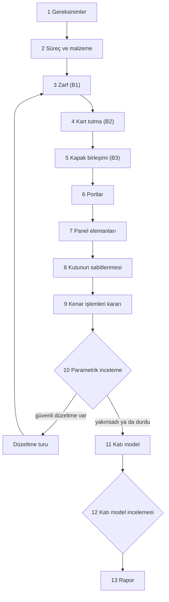

# Ikra Tasarım Algoritması

Muhafaza mühendisleri için tasarım ve inceleme el kitabı. Kapsam: alt gövde, kapak ve ayrı DIN ray klipsi; FDM, CNC ve enjeksiyon. İlgili kod: `web/js/design.js`, `web/js/dfm/catalog.js`, `web/js/treat.js`, `web/js/cad-worker.js`, `web/rules/`. Kaynakça: [KAYNAKLAR.md](KAYNAKLAR.md).

**Okuma notu.** [F8], [K5], [C4], [M1], [R1], [A3] gibi anahtarlar KAYNAKLAR.md'deki girdilerdir. Ondalık ayırıcı virgüldür; formüllerde bağımsız değişkenler noktalı virgülle ayrılır: max(0,5·d; 5·P). Durum işaretleri kuralın kaynağıyla karşılaştırılıp karşılaştırılmadığını gösterir: ✓ doğrulandı, ✎ düzeltilerek doğrulandı, ○ kontrol edilmedi. Eşiklerin bağlayıcı değeri `catalog.js` ve `web/rules/` dosyalarındadır; bu belge gerekçeyi ve dayanağı açıklar. Sayısal ayrışma görülürse katalog esastır.

## İçindekiler

1. Amaç ve kapsam · 2. Terimler · 3. Genel akış · 4. Karar sırası ve bağımlılık blokları · 5. Tasarım adımları · 6. İnceleme ve otomatik düzeltme döngüsü · 7. Kenar işlemleri politikası · 8. Süreç kuralları · 9. Elektronik muhafaza kuralları · 10. Anten ve RF kuralları · 11. Bilinen sınırlar ve sonraki aşamalar · 12. Sorumluluk notu

---

## 1. Amaç ve kapsam

Ikra, PCB'nin STEP montajından bir muhafaza tasarlar: alt gövde, kapak ve istenirse ayrı üretilen DIN ray klipsi. Her parçanın üretim yöntemi ve malzemesi ayrı seçilebilir. Çıktılar PCB ile aynı koordinatlardaki STEP/STL modeller, teknik resim, malzeme listesi ve inceleme raporudur. Bu belge kararların sırasını ve gerekçesini, kural kataloğunu ve dayanaklarını, hangi bulguların kendiliğinden düzeltildiğini, döngünün neden her zaman sonlandığını ve süreç başına kenar işlemlerini tanımlar.

**Temel ilke: ilk hesap sonuç değildir.** Tasarım üretilir, kural kataloğuna göre incelenir, güvenli bulgular düzeltilir ve tasarım yeniden incelenir. Döngü yakınsadığında ya da bir durma koşulu gerçekleştiğinde katı model kurulur, katı model de denetlenir ve tasarım inceleme raporuyla birlikte gösterilir. Bu, bilgi tabanlı tasarımdaki "öner ve düzelt" (propose-and-revise) şemasının [A5] ve EDA araçlarındaki tasarım kuralı denetiminin [A1, A2] muhafaza tasarımına uyarlanmasıdır. Ürün maliyetinin %75–85'i tasarım ve planlamada belirlendiğinden [A23] DFM kuralları hem üreticiye gömülür hem de bağımsız bir incelemeyle ayrıca denetlenir.

Ikra bir sertifikasyon aracı değildir (§12). Sonlu elemanlar, kalıp dolum, RF benzetimi ve tolerans zinciri analizi bu sürümde yoktur.

## 2. Terimler

| Terim (İng.) | Anlamı |
|---|---|
| Et kalınlığı, t (wall) | Gövde yan duvarı; taban ve kapak kalınlığı bundan türetilir. |
| Kavite, zarf | PCB'yi içine alan iç hacim; dış ölçü ve köşe radyüsleriyle tanımlı gövde kabuğu. |
| Standoff, boss | PCB'yi tabandan yükselten dikme; vida, insert ya da kılavuz deliği taşıyan kule. |
| Insert, Helicoil | Isıyla plastiğe gömülen pirinç dişli burç; tel dişli burç. |
| Pah (chamfer) | Kenarın düzlemle kırılması; "0,5 × 45°" iki kenarı 0,5 mm olan pah. |
| Radyüs (fillet) | Kenarın yuvarlatılması; iç (içbükey) ve dış (dışbükey) ayrı ele alınır. |
| Kenar kırma (edge break) | Çapağı ve keskinliği gideren küçük pah ya da radyüs. |
| Giriş pahı (lead-in) | Birbirine geçen yüzlerde yerleşmeyi kolaylaştıran pah. |
| Kalıp çıkma açısı (draft) | Kalıp açılma yönüne paralel yüzlere verilen eğim. Paralel draft: iç ve dış yüze aynı yönde, et sabit kalır. |
| Ayırma çizgisi (parting line) | Kalıp yarımlarının birleştiği çizgi; Ikra'da gövde ağzı (rim). |
| Kapak dili (lid lip) | Kapağın altından gövdeye girip kapağı konumlayan çıkıntı. |
| Yan maça (side action) | Açılma yönüne dik delik için kalıpta gereken hareketli parça. |
| Çöküntü (sink) | Kalın kesitin soğurken karşı yüzde bıraktığı çukur. |
| Fil ayağı, köprü | FDM'de ilk katmanların dışa taşması; altı boş yatay açıklık. |
| Kordon conta, kanal (gland) | Ağızdaki kanala oturan elastomer kordon; sıkıştırma ve doluluk kanalı boyutlandırır. |
| Yasak bölge (keep-out) | İçine belirli parçaların (ör. metal) giremeyeceği hacim. |

"Montaj" yalnızca birleştirme anlamındadır. Kutunun duvara ya da raya bağlanması **kutunun sabitlenmesi**, PCB'nin gövdeye bağlanması **kart tutma** olarak adlandırılır.

## 3. Genel akış



Döngü 3–10 arası aşamaları kapsar; katı model (replicad 1.2.1 + OpenCascade) yalnızca döngü durduktan sonra kurulur. Her alt problem kendi yöntemiyle çözülür: zarf ve et için kapalı formül, vida, insert ve geçme için tablo, ölçü zinciri için yayılım, port ve panel yerleşimi için arama [A8]. Parametrik denetimler her girdi değişikliğinde, katı model denetimleri yalnızca model kurulunca çalışır [A2].

## 4. Karar sırası ve bağımlılık blokları

Parametreler arasındaki bağımlılıklar çevrimlidir. Tasarım yapı matrisi (DSM) yaklaşımında karşılıklı bağımlı gruplar tek blokta toplanır ve blok içinde bir bağımlılık "yırtılır": parametre tahmini bir değerle başlar, girdisi belli olunca doğrulanır [A9].

| Blok | Parametreler | Döngüyü kuran bağımlılık |
|---|---|---|
| B1 Zarf | et, taban, kapak kalınlığı, kavite, dış ölçü, köşe radyüsleri | Dış ölçü = kavite + 2t; r_o = r_i + t. Büyük iç radyüs PCB köşesi için daha çok boşluk, dolayısıyla daha büyük kavite ister. IP kanalı ağızda et ister; kanal plan radyüsü r_i ve t'ye bağlıdır. |
| B2 Kart tutma | standoff yüksekliği, boss çapları, kapak borusu boyu, vida boyu, insert | Insert ya da diş derinliği standoff yüksekliğini; vida boyu sıkıştırılan kalınlığı (kapak, üst boşluk) izler; standart boy seçilince standoff yeniden ayarlanır. |
| B3 Kapak | kapak dili, geçme boşluğu, conta kanalı | Geçme boşluğu iki parçanın toleransından (karma kapakta genleşme farkından) gelir; kanal genişliği ağız etini, ağız eti dilin yerini sınırlar. |

Yırtılan parametre kural dosyasındaki önerilen değerle başlar. Doğrulama başarısızsa bulgu bir artış önerir, döngü (§6) bunu uygular; çevrimli bağımlılıklar sonlu turda çözülen bir sabit nokta problemine dönüşür.

**Sıranın gerekçesi.**

1. **Süreç ve malzeme önce:** tüm eşikler bunlara bağlıdır; her parça kendi sürecinin kural grubuyla değerlendirilir [A21].
2. **Zarf özelliklerden önce:** zarf geçici bir tahmindir; özellikler onu beş sayısal kanalla büyütebilir: `wall`, `pcbClearance`, `topClearance`, `standoffHeight`, `cornerRadius`.
3. **Kart tutma kapaktan, kapak portlardan önce:** kapak boruları ve vida boyu standoff yüksekliğine bağlıdır; IP kanalı port penceresinin üstünde kalacak duvar payını belirler.
4. **Portlar, panel, sabitleme sonra:** zarf içindeki yerleşim problemleridir; sığmazlarsa üst boşluk artışı isterler.
5. **Kenar işlemleri en son:** nihai topolojiye ve radyüslere bağlıdır (iç taban radyüsü iç köşe radyüsünden küçük olmalı). Conta kanalı plan radyüsü köşe radyüsünü etkilediğinden önce kesinleşir. Draft radyüslerden önce uygulanır; OCCT draft işlemi radyüslenmiş komşu yüzlerde başarısız olur.

**Kural aileleri arasındaki öncelik:** (1) sığma ve işlev (kart sığar, fiş takılır, anten yasak bölgesi, sızdırmazlık), (2) katı üretilebilirlik (en az et, takım erişimi, kalıptan çıkma), (3) yumuşak üretilebilirlik (önerilen et, düzgün et, cömert radyüs), (4) montaj ekonomisi, (5) boyut, kütle, görünüş. Bu sıra kaynaktan değil araştırmadan gelen bir tasarım tercihidir ve kod sırasıyla değil katalogdaki kural önceliğiyle ifade edilir. Katı kurallar her zaman, yumuşak kurallar mümkün olduğunca karşılanır; karşılanmayan yumuşak kural engelleyici olmaz [A12].

## 5. Tasarım adımları

**Gereksinimler.** Bugün: parça başına süreç ve malzeme, IP (yok, IP65, IP66, IP67), kapak bağlantısı, kart tutma (delikler ya da kenar tutucu), kutunun sabitlenmesi (yok, kulak, tabandan vida, DIN), port ve panel seçimleri. Gerilim, güç, ortam, RF bandı ve kirlilik derecesi henüz girdi değildir (§11).

**Zarf.** Kavite = PCB sınır kutusu ± kart–duvar boşluğu. İç köşe radyüsü PCB köşesine değecekse boşluk artırılır ve karar kaydına düşer [A27]. Karttan taşan ama dışarıdan erişim gerektirmeyen parçalar (ör. modülün PCB anteni) kaviteye alınır. Düşeyde taban üstü PCB'nin standoff yüksekliği kadar altında, kavite üstü en yüksek bileşenin üst boşluk kadar üstündedir. r_o = r_i + t eş merkezlidir; köşede et korunur [K9]. Başlangıç değerleri: `default_wall`, `pcb_clearance_xy`, `component_clearance_z`, max(`min_standoff_height`; alttan taşan + `under_board_clearance`), `corner_radius_min`.

**Kart tutma.** Vida boyutu PCB deliğinden seçilir (M2–M4). Gövde tarafı sürece göre: FDM'de ısıl insert, CNC'de kılavuz ya da Helicoil, enjeksiyonda sac vidası ön deliği. Insert boss'u = insert dış çapı + 2 × en az et [F18, F19]; kör delik insert boyu + 1 mm [F17]; CNC kılavuzunda diş boyuna ek matkap derinliği eklenir (§7).

**Kapak birleşimi.** Kapak dili yüksek bileşen varsa kısaltılır ya da kaldırılır. Geçme boşluğu süreç toleranslarından; farklı malzemeli kapakta 40 K'deki genleşme farkı eklenir. IP'de kanal derinliği = kordon çapı × (1 − sıkıştırma), genişlik doluluk sınırından, ağız eti = genişlik + 2 × yan pay (FDM'de nozul katına yuvarlanır).

**Portlar, panel, sabitleme.** Açıklığı yalnızca duvar düzlemine taşan kesit belirler. IP'de pencere zorunlu, enjeksiyonda yan maça gerekmesin diye varsayılan çentik, CNC'de köşe radyüsü takıma göredir. Panel elemanları zarf içinde aranarak yerleşir. DIN klipsi EN 60715 TS35 rayına (35 mm, 7,5 mm, 1 mm sac [M21] ○) göre boyutlanır; kilit dilinin gerinimi malzemenin izin verilen gerinimiyle karşılaştırılır.

## 6. İnceleme ve otomatik düzeltme döngüsü

### 6.1 Kural kataloğu

Tasarım bilgisi koddan ayrı, bildirimsel bir katalogda tutulur; üretici ve inceleyici aynı kataloğu okur [A1]. Her kuralın kimliği (ör. `FDM-BRIDGE`; önek aileyi gösterir: GEN, FDM, CNC, INJ, IP, RF, GEO ve bağlantı, port, kapak, sabitleme, panel aileleri), Türkçe başlığı, **nedeni** (ihlal edilirse ne olur), kaynakları, güveni (yüksek/orta/düşük), varsayılan seviyesi ve önceliği vardır. İlkeler:

- **En özgül kural kazanır:** kullanıcı kilidi > malzeme > süreç > genel varsayılan [A1, A2].
- **Düşük güvenli kural engelleyici olamaz.** Otomatik bir uyarı, parçanın yapılamayacağının kanıtı değildir [A14]; doğrulanmamış sayılar tasarımı engelleyemez.
- **Düzeltme yalnızca ihlale katkı veren parametreye dokunur;** onarım yerel ve açıklanabilir kalır [A5].

| Kimlik | Konu ve eşik | Kaynak | Düzeltme |
|---|---|---|---|
| GEN-WALL-MIN | Et ≥ `min_wall` (malzeme dosyası) | [F5], [C1], [K1] | `wall` ↑ |
| FDM-WALL-NOZZLE | Et nozul çapının katı | [F5], [F1] | `wall` bir üst kata |
| FDM-BRIDGE | Köprü ≤ 5 mm temiz, ~10 mm pratik sınır | [F8], [F16] | öneri: pencereyi çentiğe çevirme |
| FDM-INSERT-DEPTH | Kör delik ≥ insert boyu + 1 mm | [F17] | `standoffHeight` ↑ |
| CNC-CORNER-TOOL | r_i ≥ 1,3 × takım yarıçapı | [C4], [C8] | `cornerRadius` ↑ |
| CNC-CORNER-DEPTH | İdeal r_i ≥ cep derinliği/4 | [C4], [C1] | `cornerRadius` ↑ |
| CNC-TAP-DEPTH | Diş ≥ 1,5 d; ek ≥ max(0,5 d; 5 P), ≤ 5 P + 1,5 mm | [C14], [C4], [C20] | `standoffHeight` ↑ |
| INJ-DRAFT | Draft ≥ max(`draft_angle_min`; derinlik tablosu; 1°) | [K5], [K6] | geometride; olmazsa GEO-TREAT |
| INJ-CORNER-RADIUS | r_i ≥ max(0,5 t; 0,5 mm) | [K8], [K9] | `cornerRadius` ↑ |
| INJ-BOSS-WALL | Boss eti ≤ 0,6 t | [K4] | öneri (vida tablosu öncelikli) |
| IP-GROOVE-RADIUS | Kanal plan radyüsü ≥ 3 × kordon (ideal 6×) | [M1] | `cornerRadius` ↑ |
| IP-CLAMP-PITCH | Conta boyunca vida aralığı ≤ `max_clamp_pitch` | kurum varsayılanı | öneri: vida, köşe vidası |
| RF-KEEPOUT-METAL | Anten çevresinde metal (§10.1) | [R1], [R3], [R8] | öneri: plastik vida, deliği kullanmama |
| RF-METAL-BODY | İletken gövdede iç anten | [R14], [R15] | öneri: panel SMA, plastik kapak |
| RF-LOSSY-MATERIAL | Karbon elyaf, karbon siyahı, naylon | [R8] | öneri: malzeme |
| GEO-TREAT / GEO-BUILD | Uygulanamayan kenar işlemi / kurulamayan özellik | — | geri düşüş ve raporlama |

### 6.2 Bulgu ve seviyeler

Her bulgu şunları taşır: kural kimliği, seviye, kategori, parça (gövde, kapak, klips), mesaj, ölçülen değer ve sınır, konum, düzeltme (parametre, hedef, etiket; otomatik ya da öneri) ve kaynak. Mesajın ilk cümlesi tek başına anlaşılır: ne, nerede, ne kadar [A14]. Örnek: "USB-C açıklığı yanındaki duvar 0,9 mm; ABS için alt sınır 1,2 mm." Sonraki cümleler nedeni ve çözümü verir; dil yansızdır ve yapıcı bir çözüm önerir [A24]. Seviye renkle birlikte simge ve metinle gösterilir.

| Seviye | Sabit anlamı | Tasarım durumuna etkisi | Dayanak |
|---|---|---|---|
| **Engelleyici** | Parça tasarlandığı haliyle yapılamaz ya da fiziksel çakışma vardır. | "Üretime hazır"ı engeller. | Protolabs gerekli değişiklik [A15]; Fictiv kırmızı [A18] |
| **Uyarı** | Yapılabilir; kalite, maliyet ya da montaj riski var. Mesaj, göz ardı edilirse ne olacağını söyler. | "Uyarılarla hazır". | Protolabs öneri niteliğinde [A15]; Fictiv turuncu [A18] |
| **Bilgi** | Süreç notu, karar kaydı, ölçü bilgisi. | Yok; otomatik düzeltmesi olan bilgi skora 1 puan katar. | — |
| **Geçti** | Denetim çalıştı, koşul sağlandı. | Neyin denetlendiğini gösterir. | NX DFM Advisor [A20]; SARIF [A13] |

### 6.3 Otomatik düzeltme, öneri, kilit, muafiyet

**Otomatik düzeltme**, işlevi, malzeme listesini ve görünüşü değiştirmeyen, yalnızca zarfı ya da boşlukları büyüten güvenli bir adımdır [A3]. Yalnızca beş parametrenin **artışı** otomatik uygulanır: `wall`, `pcbClearance`, `topClearance`, `standoffHeight`, `cornerRadius`. Hepsi "en az şu kadar" türünden bir alt sınırı karşılar. Bir turda her parametreye tek düzeltme uygulanır; aynı parametre için birden çok istek varsa gerekli en büyük artış seçilir, çünkü en büyük değer tüm alt sınırları birlikte karşılar [A3].

**Öneri**, işlevi, uyumu ya da görünüşü değiştirebilecek her şeydir: vida boyutu ya da tipi, insert tipi, kulak veya köşe vidası ekseni, panel elemanı eklemek, bir deliği kullanmamak, port tipi, kapak bağlantı yöntemi, malzeme. Öneriler döngüde uygulanmaz; mühendis onaylarsa tek tek uygulanır ve döngü baştan çalışır. Yanıtlar Protolabs'ın üç yönlü yapısına karşılık gelir [A16]: uygula, gerekçeyle muaf tut, açık bırak.

**Kilit.** Kullanıcının elle yazdığı her parametre kilitlidir ve `.ikra.json` içinde saklanır. Döngü kural varsayılanlarının kilitli değerlerle güncellenmiş haliyle başlar ve kilitli değeri hiç değiştirmez; kilitli parametreye dokunan düzeltme öneri olarak raporlanır, bulgu açık kalır. Böylece motorun bulduğu bir değer kalıcı bir "elle girilmiş" değere dönüşmez.

**Muafiyet.** Bir bulgu, gerekçesi zorunlu olarak yazılarak muaf tutulabilir. Muaf bulgu skora ve duruma katılmaz, raporda gerekçesiyle "muaf" olarak kalır [A13]; kuralı kapatmaz, yalnızca o bulguyu kapsar [A1]. Engelleyici bir bulguyu muaf tutmak üretilebilirlik sorumluluğunu gerekçeyi yazan mühendise devreder; önerilmez.

### 6.4 Skor ve döngü

```
S = 1 000 000 · E + 1 000 · U + B
E: açık engelleyici, U: açık uyarı, B: otomatik düzeltmesi olan açık bilgi (muaflar hariç)
```

Ağırlıklar skoru uygulamada sözlük sırasına çevirir: tek engelleyici 999 uyarıdan ağırdır, bilgi yalnızca eşitliği bozar [A11]. Yeni bulgu doğuran her adım reddedilmez; toplam skor düşüyorsa daha hafif bir bulgu pahasına daha ağırını gideren adım kabul edilir.

```
P ← kural varsayılanları + kilitli değerler;  T ← ∅ (tabu);  H ← {özet(P)}
S ← skor(incele(üret(P)))
tur = 1 … 8:
    A ← açık, muaf olmayan bulguların otomatik düzeltmeleri
        (beş parametre, yalnız artış, kilitli değil, T'de değil);
        her parametre için gerekli en büyük artış
    A boşsa: dur → öneri bekleyen bulgu varsa "kullanıcı kararı", yoksa "yakınsadı"
    P' ← P + A;  özet(P') ∈ H ise: dur → "salınım"
    S' < S ise: kabul (P ← P', S ← S')
    değilse: öncelik sırasıyla en çok üç adayı tek tek dene; skoru kesin
             düşüren ilk adayı kabul et, düşürmeyenleri T'ye ekle;
             hiçbiri düşürmezse: dur → "ilerleme yok"
    H ← H ∪ {özet(P)}
8 tur dolarsa: dur → "tur sınırı"
```

Adaylar belirlenimci sıradadır: seviye (engelleyici önce), katalog önceliği, kural kimliği. Rastgelelik ya da zamana bağlı adım yoktur; aynı girdi aynı sonucu verir. Birleşik deneme skoru düşürmezse adayların tek tek denenmesinin nedeni, saf açgözlü onarımın her girdide başarılı olmamasıdır: asansör tasarımı VT denemelerinde olası girdilerin yarısından fazlasında başarısız olmuştur [A6].

### 6.5 Sonlanma güvenceleri

1. **Tur sınırı 8.** ESLint düzeltme turlarını 10 ile sınırlar [A3]; süreç araştırmaları 3–5 tur önerir. 8, tarayıcıda milisaniye mertebesinde süren turlar için düşük maliyetli bir üst sınırdır.
2. **Kesin azalan skor.** S negatif olmayan bir tam sayıdır ve kabul edilen her tur onu en az 1 azaltır.
3. **Tek yönlü, sınırlı düzeltmeler.** Yalnızca artış vardır ve her artış bir bulgunun istediği sonlu değerde durur; tek yönlü adımlar sonlu bir kümede sabit noktaya ulaşır [A10].
4. **Tabu.** Reddedilen düzeltme aynı çalıştırmada yeniden denenmez.
5. **Durum özeti.** Artışlar tek yönlü olduğundan durum kuramsal olarak tekrar edemez; özet denetimi bu varsayımı bozabilecek bir uygulama hatasına karşı ikinci emniyettir. Tekrar görülürse döngü durur ve çatışan kural çifti raporlanır [A4].

Bu gerekçe veri akışı analizindeki sabit nokta sonucuna dayanan bir benzetmedir; yayımlanmış bir DFM sonucu değildir.

### 6.6 Durma nedenleri ve tasarım durumu

| Durma nedeni | Anlamı | Mühendise düşen |
|---|---|---|
| `converged` Yakınsadı | Otomatik düzeltilebilir açık bulgu kalmadı. | Kalan uyarıları değerlendirmek. |
| `needs-user` Kullanıcı kararı | Kalan bulguların yalnız öneri türü çözümü var ya da çözüm kilitli parametreye dokunuyor. | Öneriyi uygulamak, kilidi kaldırmak ya da muaf tutmak. |
| `stalled` İlerleme yok | Hiçbir aday skoru düşürmedi. | Birbirini engelleyen bulguları incelemek. |
| `oscillation` Salınım | Parametre durumu tekrar etti. | Raporda adı geçen kural çiftini incelemek. |
| `max-iter` Tur sınırı | 8 tur doldu. | Raporu incelemek; gerekirse değer kilitleyip yeniden çalıştırmak. |

| Durum | Koşul |
|---|---|
| `ready` Üretime hazır | Açık engelleyici ve açık uyarı yok. |
| `advisories` Uyarılarla hazır | Açık engelleyici yok, en az bir açık uyarı var. |
| `blocked` Engellendi | En az bir açık engelleyici var. |

Durma nedeni ile durum ayrı bilgilerdir: döngü "kullanıcı kararı" ile durup tasarım "engellendi" kalabilir. Model her durumda gösterilir, ancak açık engelleyici varken "nihai" ya da "üretime hazır" etiketi verilmez [A17].

### 6.7 Katı model incelemesi ve rapor

Kenar işlemleri tasarımda hesaplanır, katı model kurulurken uygulanır ve her biri ayrı denenir. OCCT bir radyüs, pah ya da draftı uygulayamazsa kenar düz geometride kalır ve **GEO-TREAT** istenen işlemi, uygulanan değeri ve geri düşüşü bildirir. Bir özelliğin boolean işlemi başarısız olursa model o özellik olmadan kurulur ve **GEO-BUILD** özelliği adıyla bildirir. Böylece sessizce düşen bir işlem yüzünden tasarım "geçti" görünmez. Gerçekleşen katı, sayısal plandan boolean kenar durumlarında ayrışabileceği için niyet edilen parametrelerden bağımsız denetlenmelidir [A22].

Rapor şunları içerir: durum ve parça başına süreç/malzeme; döngü özeti (tur / 8, durma nedeni, otomatik düzeltme ve bekleyen öneri sayısı) [A25]; otomatik düzeltme günlüğü (kural, parametre önce → sonra, neden); seviye ve konuya göre açık bulgular [A18]; öneriler; gerekçeli muaflar; geçen denetimler [A20]; kenar işlemleri raporu (istenen, uygulanan, geri düşülen). Sunum en çok iki kademelidir [A26]; kalıcı pencere yalnızca engelleyici durumlar içindir [A24].

## 7. Kenar işlemleri politikası

Kenar işlemi açık bir tasarım aşamasıdır. CAD sırası: önce draft, sonra ilkel katılarda büyük radyüs ve pahlar, sonra toplu boolean işlemleri, en son geri düşüş merdiveniyle küçük yerel işlemler; OCCT radyüs işlemi boolean sonrası karmaşık topolojide başarısız olabildiği için bu sıra seçilmiştir [G1, G2]. Mümkünse radyüs 2B konturda verilir; 2B radyüs kesindir ve 3B radyüsün hata türlerine düşmez. Enjeksiyon draftı yuvarlatılmış dikdörtgenler arasında düz yüzeyli (ruled) loft ile kurulur; düzgün ölçekleme kare olmayan konturda eşit olmayan draft verir. Uygulanamayan her işlem düz geometriye döner ve raporlanır.

| Kenar sınıfı | FDM | CNC | Enjeksiyon |
|---|---|---|---|
| Taban dış alt çevresi | 0,5 × 45° pah; radyüs yok | 0,3 × 45° kenar kırma | radyüs = iç taban radyüsü + t |
| Kapak dış yüz çevresi | 0,5 × 45° pah (dış yüz tablada) | 0,3 × 45° | tanımlı değil |
| Kulak, DIN klipsi tabla kenarları | 0,5 × 45° pah | 0,3 × 45° | tanımlı değil |
| Dış dikey köşeler | r_o = r_i + t | r_o = r_i + t | r_o = r_i + t |
| İç dikey köşeler | `corner_radius_min` | ≥ 1,3 × takım yarıçapı; ideal ≥ derinlik/4 | ≥ max(0,5 t; 0,5 mm) |
| İç taban–duvar | radyüs min(1 mm; r_i − 0,05) | yok (düz taban) | radyüs max(0,5 t; 0,5 mm) |
| Ağız iç kenarı, kapak dili ucu | 0,3 giriş pahı | 0,3 giriş pahı | ağız (ayırma çizgisi) keskin; kapak dilinde draft ve kök radyüsü |
| Yan duvar ve kavite | draft yok | draft yok | paralel draft max(`draft_angle_min`; tablo; 1°); kavite nominali taban seviyesinde, yukarı büyür |
| Boss | kök radyüsü 0,5 | — | dış draft 1°, kök 0,25 t, uçta pah |
| Insert, kılavuz delikleri | insert deliği düz, pahsız; derinlik L + 1 mm | 90° havşa (diş dış çapına); ek matkap max(0,5 d; 5 P) ≤ 5 P + 1,5 mm | — |
| **Tüm süreçler** | Köşe boss'u: teğet sivri uç bırakmayan, iç köşeleri radyüslü 2B kontur. IP kanalı: taban radyüsü 0,2 mm, üst kenarda 0,13 mm kırma, plan radyüsü ≥ 3 × kordon. DIN kilit dili: kök radyüsü 0,5 t, yarık uçları yuvarlak. | | |

**Dayanaklar.**

- *FDM tabla kenarı:* UltiMaker tablada radyüs yerine pah önerir [F1] ✓; Hubs tablaya değen kenarlarda 45° pah ya da radyüs önerir [F8] ✓; tablaya bakan radyüs neredeyse yatay bir sarkmayla biter [F2] ✓. Kaynaklar boyut vermez; 0,4 mm nozulda fil ayağı ~0,2 mm'dir [F3] ✓. 0,5 mm pay bırakan bir tasarım tercihidir (düşük güven). Baskı yönü: gövde tabanı, kapak dış yüzü tablada, klips düz [F1] ○.
- *FDM iç taban radyüsü:* zorunlu değil ama gerilme yığılmasını azaltır [F7] ✎; 1 mm üst sınırı tercih, r_i − 0,05 sınırı geometriktir (aşılırsa köşedeki tor yüzeyi bozulur). *Giriş pahı:* Prusa önerir, boyut vermez [F2] ○; 0,3 tercih. *Boss kökü:* ince pimlerde kök radyüsü [F8] ○. *Insert deliği:* düz, kenar pahı genellikle gereksiz, kör delik ~1 mm derin [F17] ✓.
- *CNC kenar kırma:* NASA belirtilmemiş dış kenarlarda 0,13–0,51 mm [C20] ○, Protolabs metalde 0,25 × 45° [C16] ○ önerir; Xometry dış kenarda pahı varsayılan sayar [C7] ○. 0,3 bu aralıktadır; resimde ISO 13715 genel notu kullanılabilir [C24] ○. *Düz taban:* taban radyüsü 0, 0,5 ya da 1 mm, gerekmedikçe yok [C1, C4] ✓. *İç köşe:* §8.2.
- *CNC kılavuz deliği:* kılavuzdan önce 80–120° havşa [C20] ✓, 90° bu aralıkta. Son tam dişin altında ≥ 0,5 d [C4] ✓ ve ≥ 5 P, en çok 5 P + 1,52 mm [C20] ✓. Hubs'ın M6 altı için 1,5 d değeri M3/M4'te (4,5 / 6,0 mm) NASA üst sınırını (4,0 / 5,0 mm) aştığı için kullanılmaz.
- *Enjeksiyon draftı:* en az 0,5°, 1–2° çok iyi, derinlik ve ete göre tablo [K5] ✓; derin duvarda ilk 50 mm için 25 mm başına ~1°, 50–101 mm'de 3° ya da t ≥ 3 mm, çekirdek–kavitede ≥ 2° [K6] ✓. DuPont'un 0–0,5° değerleri yalnızca yarı kristal PA, POM, PBT içindir [K8] ✓; Ikra'nın enjeksiyon malzemeleri (ABS, PC/ABS) amorf olduğundan alt sınır 1°'dir. Paralel draft eti sabit tutar [K9] ○; kavite nominalinin taban seviyesinde tanımlanması draftın kart yüksekliğindeki boşluğu azaltmasını önler. Ayırma çizgisindeki radyüs kalıp uyuşmazlığını çapak olarak gösterir [K17] ○.
- *Enjeksiyon radyüsleri:* iç 0,5 t, üstünde kazanç azdır [K8] ✓; yüklüde ≥ 0,5 mm, yüksüzde ≥ 0,13 mm; r/t = 0,5'te gerilme yığılma katsayısı ~1,5, r/t ≈ 0,1'de ~3,0; dış = iç + t [K9] ✓. *Boss:* dış draft 1°, iç 0,5°, kök 0,25 t, 45° giriş pahı [K10] ✓. *Kapak dili* çıkıntı sayılır: draft ≥ 2° (tercihen 4°), kök 0,25–0,5 T [K12] ✓ (kapak diline uygulanması genişletmedir).
- *Köşe boss'u:* duvarlara teğet silindir, birleşimde hiçbir takımın ya da kalıbın üretemeyeceği sıfır genişlikli aralık bırakır.
- *Conta kanalı:* Parker 1,78 ve 2,62 mm kesitlerde taban radyüsü 0,13–0,38 mm, kenar kırma ~0,13 mm [M1] ✓; iç köşe ≥ 3 W, tercihen 6 W [M1] ✓. Kuralın gövde köşe radyüsüne taşınması türetilmiştir: plan radyüsü r_i ile büyüdüğü için IP-GROOVE-RADIUS `cornerRadius` artışı ister.
- *DIN kilit dili:* kök ≥ 0,5 × kök kalınlığı [F22] ○; Bayer R/h ≈ 0,6 en etkili, 0,38 mm alt sınır [K19] ○. Kare yarık uçları çatlak başlatıcıdır.

## 8. Süreç kuralları

### 8.1 FDM

| Kural | Değer | Kaynak |
|---|---|---|
| Et mutlak alt sınırı | ≥ nozul çapı (varsayılan 0,4 mm) | [F1] ✓ |
| Et katı | nozul katı (0,4 nozulda 1,0 yerine 1,2 mm); Prusa çevre katı ~0,45 / 0,9 / 1,35 / 1,8 mm | [F5] ✓, [F2] ✓ |
| Muhafaza duvarı | ≥ 2 mm önerilir; taşıyıcı duvar 1,2–1,5 mm; ≈ 4 × katman | [F10] ✓, [F14] ✓, [F7] ✓ |
| Sarkma, köprü | düşeyden ≤ 45°; köprü ≤ 5 mm temiz, ~10 mm pratik sınır | [F8] ✓, [F16] ✓ |
| Destek | parça başına sıfır destek hedefi | [F2] ✓ |
| Delikler | boşluk d + 0,25; vida diş açacaksa d − 0,25; en küçük delik 2,0, pim 3,0 mm | [F10] ✓, [F15] ✓ |
| Isıl insert | M2: delik 3,2 / et 1,3; M2.5 ve M3: 4,0 / 1,6; M4: 5,6 / 2,1 mm; düz delik, kör delik L + ~1 mm; baskı sıcaklığı + 10–20 °C | [F18] ✓, [F17] ✓ |
| Insert boss'u, kenar | Stratasys çevrede 2,03 mm; SPIROL ≥ 1,5 × (en iyi 2 ×) tırtıl çapı; kenardan ≥ 0,5 × insert çapı | [F7] ✓, [F20] ✓, [F21] ✓ |
| Kapak geçmesi, basılı diş | toplam 0,5 mm; M5 altında basılı diş yok | [F12] ○, [F11] ○ |

**Seçimler.** *Et:* Hubs 2,0, Formlabs ve UZH 1,0, Xometry 1,2–1,5 mm, Stratasys 4 × katman önerir. Ikra `default_wall`ı (ör. PETG 2 mm) varsayılan, `min_wall`ı (ör. PETG 1,2 mm) katı alt sınır, nozul çapını mutlak taban kabul eder. *Nozul katı:* Prusa çevre değerlerinin yaklaşık ve dilimleyiciye bağlı olduğunu belirttiği için Formlabs'ın nozul katı uygulanır. *Insert boss'u:* üretici tablosunun en az eti taban alınır, yer varsa daha büyük düzeyler hedeflenir.

### 8.2 CNC

| Kural | Değer | Kaynak |
|---|---|---|
| İç köşe | R ≈ 1,3 × takım yarıçapı, tam eşit değil (Protocase: %200 en iyi, %120 ideal değil); R ≥ d/3 tercih, d/4 ideal, d/8 mümkün ama pahalı | [C4] ✓, [C8] ✓, [C10] ✓, [C1] ✓ |
| Derinliğe göre en az R | 11,94 mm: R0,406 (önerilen R0,787); 19,05: R0,813 (R1,6); 50,8: R1,6 (R2,388) | [C9] ✓ |
| Takım ve cep | en küçük freze Ø1 mm, onunla cep ≤ 9,52 mm; derinlik ≤ 3–4 × D tercih, ≤ 10 × D uzun takımla; ≤ 4 × genişlik | [C12] ✓, [C1] ✓, [C18] ✓, [C4] ✓ |
| Tek taraftan derinlik | ≤ 50,8 mm | [C11] ✓ |
| Et | metal ≥ 0,8 önerilen / ≥ 0,5 yapılabilir; plastik ≥ 1,5 / ≥ 1,0 mm; ince eleman > 0,51 mm; yükseklik/kalınlık ≤ 10:1 | [C1] ✓, [C11] ✓, [C6] ✓ |
| Serbest çıkıntı | yükseklik ≤ 4 × en dar genişlik | [C2] ✓ |
| Delikler | standart matkap 0,1 mm adım (1–13 mm); derinlik ≤ 4 × D önerilen; kör delik + %25, uç 135°; kenardan metal ≥ 0,8, plastik ≥ 1,6 mm | [C4] ✓, [C1] ✓ |
| Diş | ≥ M2; boy ≥ 1,5 d, hedef 2 d, en çok tablo (M3 7,62; M4 10,16 mm); modelde ön delik çapı (M3 2,46–2,60 mm) | [C4] ✓, [C14] ✓ |
| Alüminyumda tutunma | AlMgSi1 F32, 8.8 vida: ≥ 1,4 d (M6–M16 denemeleri) | [C21] ✎ |
| Plastikte delme | 2 × D üstünde ısı birikir; delik delindikten sonra daralır | [C22] ✓ |

**Seçimler.** *Köşe radyüsü* kademelidir: 1,3 × takım yarıçapı alt sınır (CNC-CORNER-TOOL), derinlik/4 ideal (CNC-CORNER-DEPTH); Protocase tablosu yapılabilirlik tabanıdır. *Et:* önerilen ve yapılabilir değerler ayrıdır; Fictiv'in 0,25 mm metal sınırı muhafaza için kullanılmaz; kural dosyaları (ör. 6061'de `min_wall` 1 mm) daha tutucudur. *Kılavuz ek derinliği:* §7.

### 8.3 Enjeksiyon

| Kural | Değer | Kaynak |
|---|---|---|
| Nominal et | ABS 1,14–3,56; PC 1,02–3,81 mm; el boyu parça 2,0, kararlı 1,5–2,5, ≥ 3,8 mm çöküntü | [K1] ✓, [K2] ✓ |
| Et oranı, geçiş | ince et ≥ komşunun %40–60'ı; geçiş boyu ≥ 3 × kalınlık farkı | [K1] ✎, [K16] ✓ |
| Radyüs | iç 0,5 t (yüklüde ≥ 0,5 mm, mutlak ≥ 0,13 mm); dış = iç + t | [K8] ✓, [K9] ✓ |
| Draft | ≥ 0,5°, 1–2° iyi, ~1°/25 mm; tablo örneği 25,4 mm derinlikte t 1,5 → 2°, t 2,0 → 1°; doku için her 0,025 mm'ye +1,5° | [K5] ✓, [K13] ✓ |
| Kapama yüzeyi | ≥ 3° (Protolabs), 5° (Ticona) | [K9] ✓ |
| Nervür | kalınlık 0,4–0,6 t; yükseklik uyarı > 3 t, hata > 5 t; aralık ≥ 3 t | [K3] ✓, [K9] ✎, [K10] ✎ |
| Boss | dış çap 2–3 × delik; et ≤ 0,6 t; duvara gömülmez, nervürle bağlanır | [K8] ✓, [K4] ✓, [K10] ✓ |
| Sac vidası boss'u | EJOT PT, ABS: ön delik 0,80 d, boss 2,00 d, dalma 2,00 d; PC (AMTEC): 0,85 d, 2,0–2,6 d, 2,0–2,4 d | [K11] ✓ |
| Ayırma çizgisi | keskin kenarda; açık kutuda ağız | [K17] ○ |

**Seçimler.** *Boss çapı ve eti:* vida tablosu (2 d boss) M2,5–M3'te 2 mm ette boss etini ~0,8–0,9 t'ye çıkarır. İşlev öncelikli olduğu için tablo kazanır; INJ-BOSS-WALL engelleyici değil uyarıdır ve çöküntü önlemi önerir (dıştan oyma, duvardan ayırma, kozmetik olmayan yüz). *İç radyüs:* 0,5 t varsayılan; 1,0 t yalnızca çok yüklü köklerde. *Draft:* amorf malzemelerde varsayılan 1° (§7).

## 9. Elektronik muhafaza kuralları

### 9.1 Boşluklar

| Kural | Değer | Kaynak | Ikra |
|---|---|---|---|
| PCB–iç duvar | ≥ 0,5 mm + süreç payı; kart yalnız duvarla konumlanıyorsa (FDM) 1,5–2,0 mm | [M20] ○, [F6] ○ | `pcb_clearance_xy` (PETG 0,5; ABS enj. 0,4; 6061 0,3 mm) |
| Port açıklığı | yuvarlakta çapa +0,2–0,3 mm; dikdörtgende yan başına ~1 mm, karşı fişe göre | [M20] ○, [F10] ○ | `cutout_clearance_xy`; karşı fiş zarfı henüz denetlenmiyor |
| PCB altı | en uzun alt çıkıntı + ≥ 1 mm + tolerans | [M25] ○ | `under_board_clearance` 1 mm; pay 0,2 mm'nin altına inerse engelleyici |

### 9.2 IP ve conta

**IP birinci rakam:** IP1X 50 mm, IP2X 12,5 mm küre, IP3X 2,5 mm çubuk (3 N), IP4X 1,0 mm tel; IP5X/6X'te 2–8 saat talk testi [M2] ✓. IP5X ve üstünde açık havalandırma yerine membran kullanılması tutucu bir tercihtir (IEC 60529 IP5X sınırlı toz girişine izin verir). **İkinci rakam:** IPX3 düşeyden 60°'ye kadar püskürtme, nozul yönteminde ≥ 5 dk, boru yönteminde 10 dk (kaynaktaki "3 dk" düzeltildi); IPX5 6,3 mm nozul, 12,5 L/dk, 2,5–3 m, ≥ 3 dk; IPX7 0,15–1 m, 30 dk [M2] ✎. IPX5 ve üstü kesintisiz conta, sızdırmaz port ve yalnızca membranlı havalandırma ister; IPX7 ile IPX5/6 ayrı iddialardır.

| Conta kuralı | Değer | Kaynak |
|---|---|---|
| Sıkıştırma | hedef %20–30; kesit penceresi W1,78 %19–32, W2,62 ve W3,53 %20–30. %30 "en çok önerilen" değerdir (uyarı eşiği); kesit penceresinin üst sınırı katı sınırdır. En az 0,2 mm. | [M1] ✎ |
| Doluluk, uzama | %60–85, hedef %75, boşluk ≥ %10; kordon uzaması ≤ %5 | [M1] ✓ |
| Kanal (W2,62) | derinlik 1,88–2,03, genişlik (sıvı) 3,45–3,61, taban R 0,13–0,38 mm | [M1] ✓ |
| Kanal köşesi | ≥ 3 W, ideal 6 W (W = 2,0 → ≥ 6, ideal 12 mm) | [M1] ✓ |
| Köpük conta | %25–35 sıkıştırma; plastik gövdede %25'te < 10 psi | [M3] ✓ |
| Vida aralığı | sabit tablo yerine kapak şeridinin sehim hesabı önerilir; sayısal kaynak yok | [M3] doğrulanamadı |

`sealing.json`: IP65 kordon 1,5 mm, %20; IP66 ve IP67 kordon 2,0 mm, %25; doluluk üst sınırı %85; vida aralığı üst sınırı 80 / 60 / 50 mm. Sıkıştırmalar Parker penceresindedir. 1,5 ve 2,0 mm kordonlar Parker standart kesitleri (1,78 / 2,62 / 3,53) değildir, kurum değeri olarak kaydedilmiştir. Vida aralığı tablosu kurum varsayılanıdır; IP-CLAMP-PITCH katı kanıt sayılmaz.

### 9.3 Havalandırma ve yoğuşma

Sıcaklık ya da rakım değişimine açık IP65 ve üstü kutuya, düşey yan duvarın üst kısmında membranlı basınç dengeleme elemanı konur; bu elemanla IP68 hedeflenmez [M4] ✓. Ikra IP seçildiğinde bu elemanı panel önerisi olarak sunar. Yoğuşma bekleniyorsa takılı konumdaki en alt noktaya tahliye konur; tahliyelerin çoğu IPx5'tir ve IP sınıfını sınırlar [M4] ✓. Çiy noktası Magnus formülüyle (b = 17,625; c = 243,04 °C) hesaplanmalıdır; kaynağın örnek değerleri hatalıdır: 30 °C'de %70 nemde çiy noktası ~23,9 °C (~6 K), %40'ta ~14,9 °C (~15 K). Kendi ısısıyla biraz sıcak kalan kutuda yoğuşma olmaz; havalandırma nem almaz ve soğutmaz [M4] ✎.

### 9.4 Açıklık sınırları

Açıklık, etkin koşulların en kısıtlayıcısına göre boyutlanır:

| Koşul | Sınır | Kaynak |
|---|---|---|
| IP3X / IP4X | en küçük ölçü < 2,5 / < 1,0 mm | [M2] ✓ |
| Yangın muhafazası, üst ve yan (PIS üstü koni) | hiçbir ölçü > 5 mm değil ya da genişlik ≤ 1 mm; aksi halde iğne alev testi | [M6] ✓ |
| Yangın muhafazası, alt | ≤ 3 mm ya da ≤ 1 mm genişlik; V-1 parça altında ≤ 6 / ≤ 2 mm; PIS altında 30 mm silindir; 3. baskıda 5° aşağı izdüşüm (15 mm'ye kadar), kafes seçeneği kaldırıldı | [M6] ✓, [M8] ✓ |
| Yabancı cisim (Ek P): PS2/PS3 üstü, yerden < 1,8 m | ≤ 5 mm ya da ≤ 1 mm; ya da IP3X/IPX4; ya da panjur | [M6] ✓ |
| EMC (metal gövde) | §9.8 | [M17] ✓ |

1 mm'den dar yarık IP4X, üst açıklık ve Ek P'yi birlikte sağlar; 3 mm delik alt sınırı sağlar ama IP3X/IP4X'i sağlamaz. Ikra bu sürümde havalandırma yarığı üretmez; kurallar bu özellik eklendiğinde etkinleşecek ve bağlayıcı koşul adıyla raporlanacaktır.

### 9.5 Termal kaba tahmin

Sızdırmaz kutuda Q = k · A · ΔT, sac çelikte k = 5,5 W/m²K [M13] ✓; altı yüzü serbest kutuda ΔT [K] ≈ 0,21 · q [W/m²] + 0,6 [M15] ✓. Plastik için dolaşan k ≈ 3,5 W/m²K doğrulanmamıştır, kullanılmaz. Fanla V [m³/h] = f · Q / ΔT, f rakıma göre 3,1–3,5 m³K/Wh [M14] ✓. Isıl ped tüm tolerans aralığında %10–30 sıkışmalı, ~6,9 N/cm² (10 psi) basınç; pedler tek kullanımlıktır [M16] ✓. Ölçüt: en yüksek ortam + ΔT, en düşük sınırın (bileşen, pil, `max_service_temp_c`/HDT) payla altında kalmalıdır; aşılırsa sırasıyla duvara ısı yolu, yüzey büyütme, RF/EMC izin veriyorsa metal gövde, §9.4 sınırlarında havalandırma, en son fan. Güç girdisi olmadığından bu denetim etkin değildir.

### 9.6 Yangın ve malzeme sınıfı

PS1 ≤ 15 W, PS2 ≤ 100 W, PS3 > 100 W. PS2 yangın muhafazası gerektirmez; ancak gövde dahil yanıcı parçalar her potansiyel tutuşma kaynağından (PIS) 13 mm / 50 mm yangın konisi mesafesinde olmalı, değilse V-1 ya da V-0 gerekir; HB gövde yalnızca mesafe sağlanırsa kabul edilir. PS3 varsa ve yayılmayı kontrol yöntemi kullanılıyorsa kutu yangın muhafazasıdır, en az V-1 gerekir [M7] ✓. 1750 mm³'ten küçük ya da 4 g'dan hafif yanıcı parçalar muaftır; yanıcı parçalar kendiliğinden tutuşma sıcaklığının %90'ının (ya da 300 °C) altında kalmalıdır [M7, M8] ✓. UL 94: V-0 ≤ 10 s, V-1/V-2 ≤ 30 s (V-2'de alevli damla serbest), HB en düşük, 5VA delinmesiz [M9] ✓. Sınıf yalnızca test edilen kalınlık ve üstünde geçerlidir; en ince et listelenen kalınlıktan az olmamalıdır. Kural dosyalarında alev sınıfı alanı henüz yoktur.

### 9.7 Yalıtım: hava aralığı ve yüzey kaçak yolu

Bu kurallar gerilim ve kirlilik derecesi girdisi gelince etkinleşecektir; bugün metal gövdede yalnızca bilgi notu verilir. ES1 ≤ 60 V DC, ES2 ≤ 120 V DC, şebeke ES3; ES3 ile erişilebilir parça arasında güçlendirilmiş yalıtım gerekir [M10] ✓.

Yüzey kaçak yolu, temel yalıtım, mm (IEC 60664-1 Tablo F.4) [M10] ✓:

| Gerilim (RMS) | KD1 | KD2 MG I | KD2 MG II | KD2 MG III |
|---|---|---|---|---|
| 63 V | 0,20 | 0,63 | 0,90 | 1,25 |
| 250 V | — | 1,25 | 1,8 | 2,5 |
| 400 V | 1,0 | 2,0 | 2,8 | 4,0 |
| 800 V | 2,4 | 4,0 | 5,6 | 8,0 |

KD: kirlilik derecesi (KD1 sızdırmaz/kaplanmış kart, KD2 ofis, KD3 endüstri, KD4 dış ortam); MG: malzeme grubu, bilinmiyorsa IIIb. Güçlendirilmişte değer iki katıdır; satırlar arası doğrusal ara değer alınır. **Hava aralığı:** OVC II'de darbe gerilimi ≤ 150 V şebekede 1500 V, ≤ 300 V'ta 2500 V; KD2 temel yalıtımda 1,5 kV için 0,5 mm (IEC 62368-1: 0,76), 2,5 kV için 1,5 mm (1,8), 4,0 kV için 3,0 mm (3,8); güçlendirilmişte bir üst kademe; 3000 m'de katsayı 1,14 [M10] ✓. **Katı yalıtım:** plastik duvar tek yalıtımsa güçlendirilmişte ≥ 0,4 mm [M11] ✓; ince ya da katman boşluklu FDM duvar katı yalıtım sayılmaz. ES3 iletkeninden birleşim yerleri, yarıklar ve dışa uzanan metal vidalar üzerinden giden yollar güçlendirilmiş değerleri sağlamalıdır ○. Eksik girdide varsayım: MG IIIb, KD2, 2000 m, OVC II.

### 9.8 EMC (metal gövde)

SE = 20 · log10(λ / 2L) − 20 · log10(n), L ≤ λ/2 için; 100 MHz'de açıklık ≤ 10 mm [M17] ✓. 1 GHz'de 40 dB için ~1,5 mm, 2,45 GHz'de 20 dB için ~6,1 mm; iki vida arası en az vida aralığı boyunda bir açıklık sayılır; dalga kılavuzu kesimi f_c [GHz] = 150 / g [mm] [R15] ✓. Kapalı metal ekrandan gerçekçi beklenti 30–40 dB'dir [R12] ✓. Eloksal yalıtkandır; temas ve topraklama yüzeyleri maskelenir [C17] ○. Frekans girdisi olmadığından etkin değildir.

## 10. Anten ve RF kuralları

### 10.1 Yasak bölge

| Durum | Mesafe | Kaynak |
|---|---|---|
| ESP32 modül PCB anteni, kutu içinde tüm yönlerde | ≥ 15 mm | [R1] ✓ |
| Microchip WBZ45 tipi iz anteni: genel / metal aralayıcı | ≥ 10 / ≥ 31,75 mm | [R3] ✓ |
| Esnek PCB anten: metal, bileşen, toprak / diğer metal | ≥ 20 önerilen / ≥ 4 mm | [R8] ✎ |
| Metal yüzey yakını | < 10 mm ciddi kayıp, 10–15 mm uygulanabilir, > 15 mm kabul; kayıp 3–10 dB | [R14] ✓ |
| Metal şasi, standoff, insert, vida | ≥ 25,4 mm | [R4] ○ |
| Çip anten üstü/altı toprak, pil, metal plaka | > 6 mm | [R6] ✓ |
| GNSS yama: kapak / 3 mm'den yüksek bileşen / modül kenarı | ≥ 5 / ≥ 10 / ≥ 10 mm | [R13] ✓ |
| Hücresel gömülü anten, diğer metal | 20 mm | [R9] ✓ |

**Seçim:** önce modülün veri sayfası, sonra üretici ailesi, en son genel kural. Değerler ortalanmaz; özgüllük eşitse en tutucusu alınır. Mesafeler bant ve parçaya özgüdür (çoğu 2,4 GHz, GNSS L1, LTE); başka bantlara milimetre ölçeklenerek değil dalga boyu kurallarıyla taşınır. **RF-KEEPOUT-METAL** yasak bölgeye giren metal bağlantı elemanlarını (vida, pirinç insert, metal standoff) arar; mesafe katalogdadır, modüle özgü değer yoksa doğrulanmış en yaygın değer 15 mm [R1] kullanılır.

### 10.2 Metal gövde ve malzeme

İletken gövdede (ör. CNC 6061) iç anten varsa **RF-METAL-BODY** şu çözümlerden birini önerir: panel SMA ile dış anten (önden takılan örnekte Ø6,40 mm D delik, 5,99 mm düzlük, panel ≤ 2,90 mm [R18] ✓; arkadan takılanda Ø6,35 ± 0,05 mm, panel ≤ 10,5 mm [R19] ✓); en uzun kenarı ≥ λ0/2 olan yalıtkan RF penceresi (2,45 GHz'de 61 mm, 1575,42 MHz'de 95 mm, 868 MHz'de 173 mm) [R14] ✓; ya da plastik kapak. Metal kaplama ya da iletken conta antenin üstünü örtmez; RF penceresi açıklık sınırından muaftır.

Plastik antene dielektrik yük bindirir: 2,4 GHz'de plastik kasadaki MIFA anten 100–200 MHz aşağı kaymıştır [R5] ✓. TI örneğinde 868 MHz anten kasaya 1 mm uzaklıkta 862,875 MHz'e kaymış (SWR 2,53:1, %18 güç kaybı), elde 847 MHz'e (SWR 6,61:1, ~%50 kayıp); TI kaymanın öngörülemeyeceğini, ölçülmesi gerektiğini belirtir [R7] ✓. Esnek antenlerin çoğu 2–3 mm ABS'ye göre ayarlanır; anten üstündeki et ve malzeme ayar koşuluyla aynı kalmalı, karbon siyahı ve nem çeken naylondan kaçınılmalıdır [R8] ✓. **RF-LOSSY-MATERIAL** karbon elyaf dolgulu malzemeleri (PA-CF, PETG-CF) anten bölgesinde işaretler [R16] ○. 1 MHz dielektrik sabitleri (ABS 3,2–3,3; PC 2,9; POM 3,7) yalnızca sıralama içindir [R22] ○. FDM dolgu oranı εr'yi güçlü değiştirir (3,5 GHz'de PLA %100'de 2,89, %25'te 1,60) [R23] ○; anten üstü duvar tam dolu basılmalıdır.

### 10.3 Yerleşim

Anten kart kenarında, özelliksiz bir duvara ya da kapağa bakar; kenar tutucu, kart kılavuzu ya da kulak anten kenarının önüne gelmez [R1] ○, [R4] ○. DIN rayı ve metal pano antenin yakınındaki metal sayılır; kapalı metal panoda dış anten önerilir [R7] ○. U.FL fişinin takılı yüksekliği en çok 2,5 mm'dir; 1,13 mm koaksiyelde bükme yarıçapı tek bükümde ≥ 5, sürekli esnemede ≥ 30 mm [R20] ✓, [R21] ✓; kablo < 150 mm, döngüsüz [R8] ✓.

### 10.4 Doğrulama planı

Ikra'nın RF kuralları yalnızca geometrik ön koşulları denetler; kutunun anteni kaydırdığı ve bunun öngörülemeyeceği konusunda kaynaklar birleşir [R7]. Şu ölçümler her durumda gereklidir:

- Bant boyunca S11 ≤ −10 dB; serbest uzayda, kutuda ve elde ya da takılı konumda (vücut yerine 0,33 L su şişesi) [R17] ○.
- Tam dizilmiş kart son kutudayken eşleştirme devresinin yeniden ayarı [R5] ○; son üründe veri hızı ve menzil testi [R1] ○.
- Hücresel üründe anten verimi (ABD, PCB > 107 mm) alt bantta ≥ %32, üstte ≥ %50, Avrupa'da ≥ %20; bant kenarında geri dönüş kaybı ≥ 4 dB [R10] ✓; kutu kapalı TRP/TIS hedefleri, ör. GSM850 TRP ≥ 26 dBm, TIS ≤ −99 dBm [R9] ✓.
- GNSS hücresel vericinin yanındaysa ≥ 40 dB yalıtım; 10 dB yalnızca ana ve çeşitleme hücresel anten çifti içindir [R12] ✎.

## 11. Bilinen sınırlar ve sonraki aşamalar

| Konu | Bugün | Sonraki adım |
|---|---|---|
| Gereksinim girişi (gerilim, güç, ortam, rakım, RF bandı, kirlilik) | Yok; yalıtım, termal, yangın ve EMC kuralları etkin değil. | Gereksinimler adımı; eksik girdide tutucu varsayılan ve "varsayım" işareti. |
| Katı üzerinde et haritası | Yok; inceleme parametrik, katıdan yalnızca kenar işlemi ve kurulum raporu gelir. | Işın örneklemesiyle et haritası; ince, kalın, değişken bölgeler [A22]. |
| Boss oyma, nervür, gusset, köşe bloklarının boşaltılması | Üretilmiyor; INJ-BOSS-WALL yalnız uyarır; köşe boss'u ve kenar tutucu pedleri dolu. | Özellik üreticileri [K2, K4, K10]. |
| 3B bulgu işaretçileri | Vurgulama yalnızca PCB bileşenlerinde. | Gövde özelliklerine kimlik; bulgudan modele git [A1, A20]. |
| Doku draftı | Doku girdisi yok. | Doku derinliğine göre ek draft [K13]. |
| Anten yasak bölgesi | Tek mesafe; modüle özgü değer girilemiyor. | Metal ve dielektrik için iki bölgeli model. |
| Conta | Sabit vida aralığı tablosu; doluluk alt sınırı (%60) ve hedefi (%75) veride yok. | Kapak şeridi sehim modeli; Parker penceresinin tamamı. |
| FDM sarkma özellikleri | Damla delik ve kurban katman yok; baskı yönü sabit. | Özellik taramasıyla sarkma ve köprü denetimi. |
| CNC kurulum, ham malzeme, özellikler arası takım erişimi | Denetlenmiyor. | Yeni CNC kuralları [C1, C2]. |
| Tolerans zinciri | Yalnızca kapak geçmesinde. | En kötü durum ve RSS tablosu. |
| Bulgu izleme | Kalıcı parmak izi, önceki çalıştırmaya göre yeni/değişmemiş etiketi, SARIF benzeri dışa aktarım ve kural başına seviye ayarı yok. | [A13], [A1] |
| Katalog yakınsama denetimi | Her engelleyicinin düzeltmesi olduğu ve zıt yönlü düzeltme bulunmadığı yüklemede denetlenmiyor. | Statik katalog denetimi [A7]. |
| Titreşim, DFA | Yok. | Steinberg yaklaşımı [M23]; parça sayısı ve tek yönlü montaj [A28, M24]. |

## 12. Sorumluluk notu

Ikra'nın raporu yalnızca şunu söyler: **"tasarım niyeti X kuralıyla (kaynak) uyumludur."** Hiçbir zaman "sertifikalı", "standarda uygun" ya da "onaylı" demez. IEC 62368-1 baskıları arasındaki farklar ve IEC 60529 test ayrıntıları laboratuvar onayı gerektirir.

Kurallar yayımlanmış kılavuzların tipik değerleridir; üretici (baskı servisi, atölye, kalıpçı) kendi sınırlarını uygular ve nihai karar üreticinin DFM incelemesi ile prototip testleriyle verilir. Otomatik uyarı parçanın yapılamayacağının kanıtı değildir [A14]; geçen bir denetim de kusursuzluk güvencesi vermez. Kozmetik yüz, yolluk girişi (gate) ya da ayırma çizgisi gibi seçimler mühendis incelemesine bırakılır; sürümden önce son katı model ayrıca incelenmelidir [A19].
